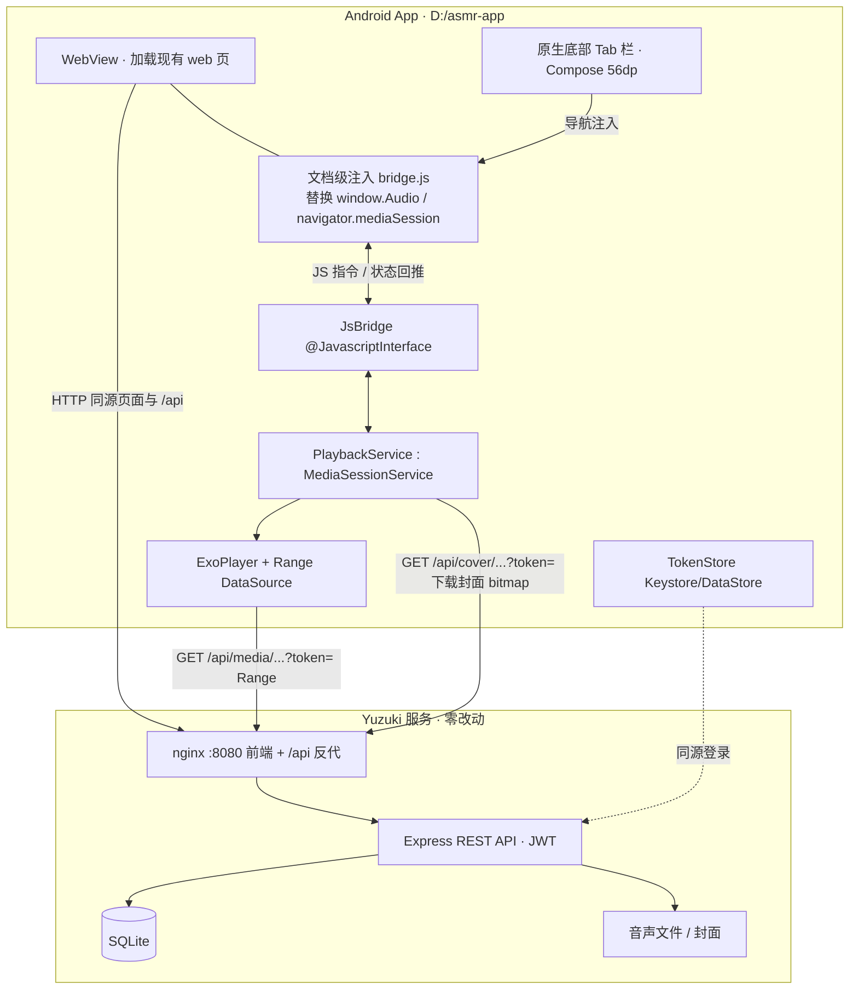

# Yuzuki Android 客户端实施方案

> 状态：**待确认后编码**。本文件自包含，可直接作为 AI 编码任务的实现规格。
> 源项目：`D:\node\yuzuki`（**只读引用，禁止修改**）｜目标工程：`D:\asmr-app`（新建）
> 依据：`README.md`、`CLAUDE.md` 及下列已核实的源码契约。

---

## 0. 目标与硬约束

| # | 约束 | 落地判定标准 |
|---|---|---|
| C1 | **不能影响现有 web 端正常使用** | `D:\node\yuzuki` 仓库**零文件改动**；后端**零新增接口、零 schema 变更、零配置变更**；PC 浏览器全流程回归通过 |
| C2 | **复用现有后端，账号是同一个** | 只调用现有 `/api/*`，App 用 `POST /api/auth/login` 登录同一 `users` 表；收藏 / 历史 / 偏好与 web 端互通 |
| C3 | **播放支持锁屏** | 原生 Media3 `MediaSessionService`：后台续播、锁屏卡片、通知栏、蓝牙/线控、换曲后通知不消失 |
| C4 | **界面复刻 web 端移动版** | 除底部三个 Tab 外，顶栏胶囊、抽屉侧栏、悬浮控制栏、迷你播放条、全屏播放器全部由 WebView 内的现有前端渲染，App 不重画 |

### 核心技术路线（一句话）

**App = 一个加载现有 web 页的专用 WebView 壳 + 原生 Media3 播放内核 + 原生底部 Tab 栏。**
通过「文档级 JS 注入」把 `window.Audio` 与 `navigator.mediaSession` 透明代理到原生播放内核，从而在**不改一行前端代码**的前提下，让现有 UI 自动获得原生播放与锁屏能力。

### 为什么选「直连现有 web 页」而不是「复制前端产物 / 原生重写」

- WebView 加载 `http://<局域网IP>:8080/`，同源 `/api` 直通，前端一行不改 → C1/C2 天然满足
- 手机视口宽度 < 760px 自动命中 web 端移动断点 → 顶栏 / 抽屉 / 悬浮栏 / 全屏播放器 **100% 一致**，无需复刻 → C4 天然满足
- 前端发版后 App 无需重装；后续修 bug 只改一处
- 代价：离开家中 WiFi 无法加载界面（离线方案见 §9）

---

## 1. 已核实的源码契约（编码时可直接依赖，勿再猜测）

| 契约 | 精确位置 | 对 App 的意义 |
|---|---|---|
| `authMiddleware` 同时接受 `Authorization: Bearer` 与 `?token=` | `backend/src/auth.ts:63-77` | **媒体流可直接 `GET /api/media/...?token=`，后端无需任何改动** |
| JWT 有效期 30 天，payload `{userId, username, exp}` | `backend/src/auth.ts:6,24-56` | 过期跳登录；无需 refresh 机制 |
| `/api/health` 公开，`/api/auth` 公开，其余 `/api` 全部需鉴权 | `backend/src/index.ts:46-64` | 服务可达性自检用 `/api/health` |
| `GET /api/media/:rj/:fileId` 用 `res.sendFile({acceptRanges:true})` | `backend/src/routes/media.ts:37-61` | ExoPlayer 可直接 Range 流式播放与 seek |
| MIME 表已含 `flac / mkv / mp4 / wav / m4a / opus ...` | `backend/src/routes/media.ts:8-30` | 原生解码器补齐浏览器不支持的格式 |
| nginx `try_files ... /index.html` SPA 回退；`/api/` 反代后端且 `proxy_buffering off` | `frontend/nginx.conf:15-28` | 可直接 `loadUrl` 到 `/history` 等子路由；流式媒体不被缓冲 |
| axios `baseURL='/api'`，token 存 `localStorage['yuzuki_token']`，请求自动加 Bearer | `frontend/src/api/index.ts:33-49` | 注入 localStorage 即可让 WebView 复用登录态 |
| `authedUrl()` / `mediaUrl()` 给封面与媒体 URL 追加 `?token=` | `frontend/src/api/index.ts:301-314` | 原生播放器拿到的 URL 已自带 token |
| **唯一播放入口是 `new Audio()`**，之后全靠 `this.audio` 的属性/事件 | `frontend/src/stores/player.ts:123-178` | 只需替换 `window.Audio` 即可透明接管全部播放 |
| store 监听 `timeupdate / durationchange / play / pause / ended / error` | `frontend/src/stores/player.ts:128-165` | 原生需回推这 6 个事件 |
| store 使用 `src / preload / loop / volume / paused / currentTime / duration / play() / pause() / load() / removeAttribute('src')` | `frontend/src/stores/player.ts:179-263` | `NativeAudio` 必须实现的最小接口集 |
| 前端自己注册 `navigator.mediaSession`，并用 `new MediaMetadata({title, artist, album, artwork})` 写元数据 | `frontend/src/stores/player.ts:270-358` | **代理 mediaSession 即可零改动拿到锁屏封面/标题/声优** |
| `artwork[0].src` 已是 `new URL(cover, origin).href` 绝对地址且带 token | `frontend/src/stores/player.ts:341,355-357` | 原生下载 bitmap 后再喂给 MediaSession |
| 移动断点 `max-width: 760px` | `frontend/src/composables/useIsMobile.ts:4` | WebView 视口宽度天然命中，无需伪造 UA |
| `MobileDock v-if="isMobile && showChrome"`、`BottomPlayer`、`FullscreenPlayer` 常挂 | `frontend/src/App.vue:143-145` | 悬浮栏/迷你条/全屏播放器自动出现 |
| MobileDock：46×166、4 按钮 首页/T/M/R、拖动吸附、`localStorage['yuzuki_mobile_dock']` | `frontend/src/components/MobileDock.vue:47-50,72-106,189-206` | App 不拦截其触摸，位置记忆自动生效 |
| 迷你条根节点 `.bottom-player`，展开全屏播放器按钮 `.btn.expand` | `frontend/src/components/BottomPlayer.vue:2,46` | 底部「播放器」Tab 直接 `.click()` 复用全屏播放器 |
| 路由：`/` library、`/work/:rj` player、`/history` history、`/favorites`、`/settings`、`/login`、`/change-password`、`/admin` | `frontend/src/router/index.ts:14-47` | Tab 目标路由；移动端 `/admin` 已被守卫跳回媒体库 |
| 首次登录 `must_change_password` 强制跳改密页 | `frontend/src/router/index.ts:60-63` | App 不重复实现改密，WebView 内完成 |

> 已知 web 端缺陷（README「已知限制」）：Chromium 换曲后通知栏媒体控件不重建。本方案把播放与 MediaSession 全部移到原生，**App 端天然规避**；浏览器端行为保持不变，不做修复（C1）。

---

## 2. 总体架构



**分层职责**

| 层 | 职责 | 不负责 |
|---|---|---|
| 原生壳（Compose） | 状态栏、底部 Tab 栏、服务器配置页、服务不可达页、返回键 | 任何媒体库 UI、任何播放器 UI |
| WebView | 渲染现有 web 端移动界面（含顶栏胶囊、抽屉、MobileDock、迷你条、全屏播放器、设置/收藏/历史） | 实际解码音频、系统媒体会话 |
| 注入层 `bridge.js` | 把 `Audio` 与 `mediaSession` 代理到原生；提供导航/登录态辅助函数 | 改变任何可见界面 |
| JsBridge | 双向指令与状态事件，唯一真相源在原生播放服务 | — |
| PlaybackService | ExoPlayer、MediaSession、前台服务、通知栏/锁屏/线控、AudioFocus | 业务数据 |

---

## 3. C1「零影响 web 端」的具体保障（强制）

1. **工程物理隔离**：新建 `D:\asmr-app`，`D:\node\yuzuki` 全程只读。禁止复制前端产物进 APK，禁止 `npm build` 时改其配置。
2. **后端零改动**：不新增路由、不改 `authMiddleware`、不改 `AUTH_SECRET`、不改 docker-compose、不动数据库。
3. **注入作用域**：`bridge.js` 只在 App 进程内通过 `WebViewCompat.addDocumentStartJavaScript` 注入；PC 浏览器访问同一 URL 时不会执行任何注入代码。
4. **代理隔离**：`window.Audio` 的替换只影响该 WebView 上下文；页面中只有 `stores/player.ts` 使用 `Audio`，无其他音频元素，替换无副作用。
5. **MediaSession 不双占**：App 内代理掉真实 `navigator.mediaSession`，由原生会话独占系统媒体控件；浏览器端仍用其原生实现，行为完全不变。
6. **回归断言**（每阶段结束执行，见 §11 S5）：
   - `git -C D:/node/yuzuki status --porcelain` 与开工前快照**完全一致**
   - PC 浏览器：`GET /api/health` 200 → 登录 → `/api/works` 200 → `/api/favorites` → `/api/plays` → `/api/prefs` 全部与改动前一致
   - web 端 `<audio>` 播放、Media Session 注册行为不变

---

## 4. C2 账号同源设计与验证

**登录链路（与 web 端完全相同）**

```
POST /api/auth/login  {username, password}  ->  {token, username, must_change_password, prefs}
GET  /api/auth/me     Authorization: Bearer <token>  ->  {id, username, must_change_password, ...}
```

- token 存 **Android Keystore 加密的 DataStore**（禁止明文 SharedPreferences / 日志输出）
- 启动流程：`GET /api/health` → `GET /api/auth/me` 校验 token → 有效则注入 WebView，失效则进入登录
- WebView 登录态注入：在**页面脚本执行前**（`addDocumentStartJavaScript`）写入
  `localStorage.setItem('yuzuki_token', '<token>')`，同源，前端 `authStore.init()` 自动恢复登录态
- 首次登录 `must_change_password=true`：直接让 WebView 走现有 `/change-password` 路由，**App 不重复实现改密页**
- 退出登录：清 DataStore + `WebView.clearCache`/清 localStorage 中 `yuzuki_token` + 停播放服务

**同源验证断言（必须全部通过）**

| # | 断言 |
|---|---|
| A1 | App 与 PC 浏览器用同一账号登录，`GET /api/auth/me` 返回相同 `id` 与 `username` |
| A2 | App 收藏 `RJxxxx` → PC 浏览器 `GET /api/favorites` 能看到同一条记录 |
| A3 | App 播放一个文件 → PC 浏览器 `GET /api/plays` 出现同一 `userId` 的记录，且 `duration` 回写成功 |
| A4 | App 修改筛选/排序 → PC 浏览器 `GET /api/prefs` 读到同一份偏好（同一 `userId` 隔离） |
| A5 | PC 浏览器改密后，App 旧 token 请求 `/api/auth/me` 返回 401 并跳登录（证明共用一套账号体系） |

---

## 5. C4 界面复刻规范（草图映射）

### 5.1 布局树（关键：Tab 栏**不覆盖** WebView）

```
Box(Modifier.fillMaxSize().statusBarsPadding()) {
    AndroidView(WebView,
        Modifier.fillMaxWidth()
               .padding(bottom = 56.dp)      // 为原生 Tab 栏预留空间
    )
    BottomTabs(Modifier.align(Alignment.BottomCenter).height(56.dp))
}
```

草图对照（纵向自上而下，右列为归属）：

```
┌──────────────────────────────────┐
│ 状态栏（透明，原生处理）        │
├──────────────────────────────────┤
│ [≡] [  搜索胶囊  ] [排序胶囊]   │  WebView: .topbar（web 端原样）
├──────────────────────────────────┤
│                          ┌────┐  │
│   封面网格 / 内容区      │首页│  │  WebView: MobileDock
│   LibraryView 等         │ T  │  │  46x166、999px 圆角
│                          │ M  │  │  右吸附、可拖动、位置记忆
│                          │ R  │  │
│                          └────┘  │
├──────────────────────────────────┤
│ [封面] 标题   <<  >  >>  [全屏] │  WebView: .bottom-player
├──────────────────────────────────┤
│   媒体库      播放器      历史   │  原生 Compose: 56dp（唯一新增 UI）
└──────────────────────────────────┘
```

- **WebView 视口高度 = 屏幕高 − 状态栏 − 56dp Tab 栏**。这样 web 端 `position:fixed` 的 `.bottom-player` 固定底边自然贴在 Tab 栏**上方**，两层不重叠；`MobileDock` 用 `window.innerHeight` 做 `clampY` 也会自动适配新视口。
- **禁止**把 Tab 栏叠在 WebView 上再用注入 CSS 顶开底边——那会破坏 `innerHeight` 计算与悬浮栏吸附。
- 状态栏：透明 + `statusBarsPadding()`，顶栏胶囊完全由 web 端 `.topbar` 渲染，App 不画第二遍。
- 返回键：`webView.canGoBack()` 优先回退；全屏播放器打开时先关闭全屏（web 端自身手势），再回退；最后一层双击退出确认。

### 5.2 草图元素 → 实现归属

| 草图元素 | 归属 | 说明 |
|---|---|---|
| 顶部圆角栏：汉堡 + 搜索胶囊 + 排序胶囊 | **WebView 现有 `.topbar`** | 完全复用，零改动；汉堡打开 web 端抽屉侧栏 |
| 右侧竖向圆角悬浮按钮组 | **WebView 现有 `MobileDock`** | 46×166、`border-radius:999px`、首页/T/M/R、拖动吸附到最近一侧、位置记 `localStorage`；App 不拦截、不复制 |
| 中间内容区 | **WebView 现有 `LibraryView` 等** | 封面网格、筛选、无限滚动、图片模式、销量火焰徽标，全部复用 |
| 底部三个文字 Tab「媒体库 / 播放器 / 历史」 | **原生 Compose（唯一新增 UI）** | 见 §5.3 |
| 迷你播放条 | **WebView 现有 `BottomPlayer`** | 位于 Tab 栏上方，复用 |
| 全屏播放器 | **WebView 现有 `FullscreenPlayer`** | 含下滑退出、整屏蒙版、壁纸、播放列表，复用 |
| 壁纸 / 主题色 / 毛玻璃 / 圆角 / 动画时长 | **全部由 web 端读 `/api/settings`、`/api/prefs` 渲染** | App 不复制任何外观逻辑 |

### 5.3 底部 Tab 行为表

| Tab | 语义 | 实现（注入 JS） |
|---|---|---|
| 媒体库 | 回媒体库首页 | `window.__yuzukiNav('library')` → 目标 `/` |
| 播放器 | 展开**当前播放**的全屏播放器 | `document.querySelector('.bottom-player .btn.expand')?.click()`；若无 `.bottom-player`（当前无播放）则回媒体库并弹 Snackbar「暂无播放」 |
| 历史 | 播放历史页 | `window.__yuzukiNav('history')` → 目标 `/history` |

`__yuzukiNav` 必须在 `bridge.js` 中实现（现有路由是 `createWebHistory`）：

```js
window.__yuzukiNav = function (name) {
  const path = name === 'library' ? '/' : name === 'history' ? '/history'
             : name === 'favorites' ? '/favorites' : '/';
  if (location.pathname === path) { window.scrollTo({ top: 0 }); return; }
  try {
    history.pushState({}, '', path);
    window.dispatchEvent(new PopStateEvent('popstate', { state: history.state }));
  } catch (e) {
    location.assign(path);               // 兜底：nginx SPA fallback 保证可用
  }
};
```

> 导航后由 Kotlin 侧用 `evaluateJavascript("location.pathname")` 做断言；若 1.5s 内未变为目标路径，自动回退 `webView.loadUrl(baseUrl + path)`。
> **其余页面**（作品详情 `/work/:rj`、收藏、设置、改密）继续走 web 端原有侧栏抽屉与路由，App 不拦截、不新增入口。

### 5.4 圆角规范（用户强制约束）

所有框体一律圆角，复用 web 端尺度，禁止直角与 <8dp 锐角：

| 元素 | 圆角 |
|---|---|
| 底部 Tab 栏容器、服务器配置卡片、不可达提示卡片、弹窗 | 16–20dp |
| Tab 选中指示、搜索/输入胶囊、按钮 | 999dp（全胶囊） |
| 列表项、下拉、标签 | 12dp |
| WebView 内所有框体 | 保持 web 端 CSS 原值，**App 不覆盖任何样式** |

---

## 6. C3 播放内核与锁屏（核心实现）

### 6.1 双代理原理：不改前端，播放与元数据全部转到原生

`stores/player.ts` 只通过 `new Audio()` 与 `navigator.mediaSession` 播放。注入层在**文档开始前**替换这两个全局对象：

| 被代理对象 | 替身 | 效果 |
|---|---|---|
| `window.Audio` | `NativeAudio`（实现最小 HTMLAudioElement 子集） | `src/play/pause/seek/volume/loop` 全部转发到 `JsBridge` → ExoPlayer；`timeupdate/durationchange/play/pause/ended/error` 由原生回推后 `dispatchEvent`，store 状态自动更新，**迷你条 / 全屏播放器 / 进度条 / 播放历史 / 时长回写全部无需改动** |
| `navigator.mediaSession` | `FakeMediaSession` | 前端既有的 `updateMediaMetadata()` 会把 `title/artist/album/artwork` 交给替身，替身转发给原生 MediaSession → **锁屏卡片自动获得文件名、声优、封面**；`setActionHandler` 只登记不触发（锁屏控制由原生 `MediaSession.Callback` 直接驱动 ExoPlayer，避免双份控制） |
| `window.MediaMetadata` | `FakeMediaMetadata` | 同上；`artwork[0].src` 已是带 token 的绝对 URL |

> **关键**：不能简单 `delete navigator.mediaSession`。若让 `mediaSessionSupported()` 返回 false，前端就不再调用 `updateMediaMetadata()`，原生就拿不到封面/标题。必须**代理而非删除**。

### 6.2 `NativeAudio` 必须实现的最小接口

| 成员 | 行为 |
|---|---|
| `src` get/set | set 时把相对路径 `new URL(v, location.origin).href` 绝对化 → `YuzukiNative.setSource(url)` |
| `preload` | 可写空属性，no-op |
| `paused` | 由原生状态回推缓存，默认 `true` |
| `currentTime` get/set | set → `YuzukiNative.seekTo(ms)`；get 返回缓存值 |
| `duration` | 由 `durationchange` 回推，单位秒 |
| `volume` get/set | set → `YuzukiNative.setVolume(float)` |
| `loop` get/set | set → `YuzukiNative.setLoop(bool)` |
| `play()` | 返回 `Promise`，调用 `YuzukiNative.play()`，立即 resolve（不得 reject，否则 `play()` catch 会改 UI 状态） |
| `pause()` / `load()` / `removeAttribute('src')` | 转发 `pause` / `stop`；`load()` 为 no-op |
| `addEventListener` / `removeEventListener` / `dispatchEvent` | 标准 EventTarget 行为，用于回推 6 类事件 |

原生 → JS 统一入口 `window.__yuzukiOnNativeEvent(json)`，由 Kotlin 用 `webView.post { evaluateJavascript(...) }` 调用；WebView 未就绪时只保留**最新状态快照**，重建后回放一次，避免进度错乱。

### 6.3 `PlaybackService`（Media3）

```
PlaybackService : MediaSessionService()
  ├─ ExoPlayer.Builder(context)
  │    .setMediaSourceFactory(DefaultMediaSourceFactory(DefaultHttpDataSource.Factory()))
  │    .setAudioAttributes(AudioAttributes.CONTENT_TYPE_MUSIC, USAGE_MEDIA)
  │    .setHandleAudioBecomingNoisy(true)
  └─ MediaSession.Builder(this, player)
       .setCallback(SessionCallback)   // onPlay/onPause/onSkipToNext/onSkipToPrevious/onSeekTo/onSetRating...
       .setSessionActivity(打开 App 的 PendingIntent)
```

- 媒体 URL 已含 `?token=`，**无需自定义 Header**；ExoPlayer 自动发 `Range` 请求，seek 直接可用
- `DefaultExtractorsFactory` 已覆盖 FLAC / Matroska(mkv) / MP4 / WAV / M4A；`media3-decoder-ffmpeg` 作为 wma/opus 等冷门格式的**可选 P1 扩展**，首版不强制
- **前台服务与通知**：MediaSessionService 自动前台化，Media3 生成 `MediaStyle` 通知；单一 MediaSession 换 `MediaItem` 不重建会话 → 规避 README 记录的「换曲后通知栏控件消失」问题
- **锁屏封面**：`artwork[0].src` 是 HTTP URL，**不要直接把 HTTP URI 交给系统**（SystemUI 无法保证明文/鉴权加载）。原生侧用 OkHttp 下载为 bitmap → `MediaMetadata.Builder.setArtworkData(bytes, MEDIA_TYPE_IMAGE)`，或转存后经 `FileProvider` 给 `content://` URI
- **锁屏动作映射**：`onSkipToNext/Previous` → 调 JS `player.next()/prev()`（经由 bridge 的 `dispatchCommand`），`onSeekTo` → `seekTo`，`onPlay/onPause` → 直接控 ExoPlayer 并回推事件
- **进度同步**：原生每 250ms 回推一次 `timeupdate`；`MediaSession` 的 `setPositionState` 由前端 `syncPositionState()` 触发到 FakeSession，替身 no-op，进度以原生为准
- **后台/锁屏续播**：播放在 Service 中，WebView 被冻结或销毁都不影响；引导用户「忽略电池优化」，不申请唤醒锁
- **生命周期**：用户主动 `stop()` 或退出登录 → `player.release()` + 停服务；App 进程被杀时 Service 会重启，用 `onDestroy` 持久化当前曲目到 DataStore

### 6.4 Bridge 契约

**JS → Native（`@JavascriptInterface`，方法名精确）**

| 方法 | 参数 | 说明 |
|---|---|---|
| `setSource(url)` | String 绝对 URL | 换源；同 URL 视为切换播放/暂停由 JS 侧判定，见 `player.ts:183-187` |
| `play()` / `pause()` / `stop()` | — | 播放控制 |
| `seekTo(positionMs)` | Long | 绝对定位 |
| `seekBy(deltaMs)` | Long | 快进/快退，快退秒数取 `/api/settings` 的 `seek_seconds` |
| `setVolume(v)` | Float 0..1 | |
| `setLoop(enabled)` | Boolean | 单曲循环 |
| `setMetadata(json)` | String `{title, artist, album, artworkUrl}` | 来自 FakeMediaMetadata |
| `getSnapshot()` | — 返回 JSON String | WebView 重建时拉取最新状态 |
| `log(msg)` | String | 调试，**禁止传 token** |

**Native → JS 事件（`__yuzukiOnNativeEvent` 的 JSON）**

```json
{"type":"timeupdate","currentTime":123.4,"duration":1800.0}
{"type":"durationchange","duration":1800.0}
{"type":"play"}  {"type":"pause"}  {"type":"ended"}  {"type":"error","message":"..."}
{"type":"state","playing":true,"paused":false,"currentTime":123.4,"duration":1800.0}
```

**安全约束**

- `addJavascriptInterface` 仅在 `url.startsWith(serverBaseUrl)` 时启用；`shouldOverrideUrlLoading` 拦截所有外链（媒体 URL 带 token，外跳有泄露风险），外链一律用系统浏览器 Intent 打开
- 禁止 `loadUrl("javascript:...")` 传大对象，统一 `evaluateJavascript`
- bridge 方法内做参数校验与 try/catch，异常回 `error` 事件，不得让 WebView 崩溃

---

## 7. 网络与配置（仅家中 WiFi）

- 服务地址：`http://192.168.x.x:8080`（首次启动设置页填写 IP/端口 + 「测试连接」按钮 → `GET /api/health`）
- `AndroidManifest.xml` 只加一项：
  ```xml
  <uses-permission android:name="android.permission.INTERNET" />
  <application android:usesCleartextTraffic="true" ...>
  ```
- **不使用 `network_security_config.xml`**：该文件是编译期静态配置，无法按运行时才知道的局域网 IP/网段做通配，写出来只会与运行时策略冲突。
- **唯一防线是运行时 host 白名单**（`ServerConfig.kt` 实现，必须覆盖全部出站口）：
  1. 用户填写的地址必须解析为局域网 IP（`192.168.*` / `10.*` / `172.16–31.*` / `127.0.0.1`），公网域名或公网 IP 一律拒绝并提示；
  2. `WebViewClient.shouldOverrideUrlLoading` 与 `shouldInterceptRequest` 对每个请求校验 host 与已保存地址**完全一致**；
  3. `YuzukiApi`（OkHttp）与 `ArtworkLoader` 使用同一校验函数，禁止拼外部 URL；
  4. 媒体 URL 带 `token=`，因此**任何外链跳转都必须拦截**（见 §6.4）。
- 验收断言包含：填入 `https://example.com` 被拒绝；把 baseUrl 改成另一台局域网 IP 后页面仍不能加载到旧地址；`addJavascriptInterface` 仅在 host 校验通过时启用。
- 若日后要走出家中 WiFi（公网/HTTPS），必须先给 nginx 加 TLS，再把 `usesCleartextTraffic` 改回 false —— 列为后续事项，本期不做。
- 服务不可达：显示原生圆角提示卡片（标题 + 当前地址 + 「重试 / 修改地址」按钮），不白屏
- P1 可选：NSD/mDNS 自动发现局域网服务

---

## 8. 工程结构与文件职责

```
D:\asmr-app\
├── 方案.md                              # 本文档（唯一规格来源）
├── settings.gradle.kts
├── build.gradle.kts
└── app\
    ├── build.gradle.kts
    ├── proguard-rules.pro
    └── src\main\
        ├── AndroidManifest.xml          # usesCleartextTraffic=true；host 白名单在运行时校验
        ├── res\values\{strings.xml, themes.xml}
        ├── assets\bridge\yuzuki-bridge.js
        └── java\com\yuzuki\app\
            ├── YuzukiApp.kt               # Application，DI 初始化
            ├── MainActivity.kt            # 单 Activity，Compose 入口，返回键分发
            ├── ui\
            │   ├── RootScreen.kt          # Box 布局：WebView + 56dp 底部 Tab（§5.1）
            │   ├── BottomTabs.kt          # 三个文字 Tab，圆角 16dp，选中态主题色
            │   ├── ServerSetupScreen.kt   # 首次启动填地址 + 测试连接
            │   ├── UnreachableScreen.kt  # 服务不可达提示卡片
            │   └── theme\{Theme.kt, Radius.kt}
            ├── web\
            │   ├── YuzukiWebView.kt       # WebView 配置、外链拦截、document-start 注入
            │   ├── BridgeInjector.kt     # 读取 assets/bridge/*.js，拼 token 后注入
            │   ├── JsBridge.kt           # @JavascriptInterface 全部方法（§6.4）
            │   └── NavController.kt     # Tab -> __yuzukiNav / openPlayer，含超时回退
            ├── playback\
            │   ├── PlaybackService.kt     # MediaSessionService + SessionCallback
            │   ├── PlayerHolder.kt       # ExoPlayer 单例、状态机、250ms 回推
            │   ├── NativeAudioState.kt  # 最新状态快照（供重建回放）
            │   └── ArtworkLoader.kt     # OkHttp 下载封面 -> setArtworkData
            └── data\
                ├── TokenStore.kt         # Keystore 加密 + DataStore，token/username
                ├── ServerConfig.kt       # baseUrl 校验（仅局域网 IP）
                ├── YuzukiApi.kt          # Retrofit：login/me/health/favorites/plays/prefs
                ├── OfflineCache.kt       # Room（P1）
                └── PendingPlays.kt       # 离线播放记录补报队列（P1）
```

**依赖版本（锁定）**

| 项 | 版本 |
|---|---|
| compileSdk / targetSdk | 35；minSdk 26 |
| AGP / Kotlin | 8.7.x / 2.0.x（Compose Compiler 随 Kotlin） |
| `androidx.media3:media3-exoplayer` / `media3-session` | 1.4.1 |
| `androidx.webkit:webkit` | 1.12.1（`WebViewCompat.addDocumentStartJavaScript`） |
| `androidx.compose` BOM / `activity-compose` | 2024.10.00 / 1.9.x |
| OkHttp / Retrofit / Kotlinx Serialization | 4.12.x / 2.11.x / 1.7.x |
| DataStore / Room / Coil | 1.1.x / 2.6.x / 2.6.x（Room、Coil 仅 P1） |

> `addDocumentStartJavaScript` 需较新 WebView；低版本设备回退到 `onPageStarted` + `evaluateJavascript`，并断言 `window.__YUZUKI_BRIDGE_READY__ === true`，否则显示「请升级 Android System WebView」。

---

## 9. 离线缓存（P1，P0 预留接口）

用户已确认「在线为主 + 离线缓存」。因本方案 WebView 直连服务端，**必须先说明取舍**：离开 WiFi 时页面与 `/api` 都不可达，因此离线分两层实现，P0 只做第 1 层。

1. **P0 壳可开**：`WebSettings.cacheMode = LOAD_CACHE_ELSE_NETWORK`，nginx 对静态资源 `expires 30d`（`nginx.conf:31-34`），断网后 WebView 仍能渲染壳与已缓存资源；`/api` 失败显示不可达提示。
2. **P1 数据离线**：`WebViewClient.shouldInterceptRequest` 拦截 `/api/works|works/:rj|cover/*|favorites|plays|prefs`，命中 Room 副本时返回缓存 JSON/图片；音频下载到 `filesDir/offline/{rj}/{fileId}`，`PlayerHolder` 优先本地 `FileDataSource`，无网时仍可播。
3. **P1 历史补报**：离线期间的播放记录写入 `PendingPlays` 队列，检测到 `/api/health` 恢复后按时间顺序补 `POST /api/plays` 与 `POST /api/plays/:id/duration`；去重键 `(rj, fileId, startedAt)`，避免与前端 `sendBeacon` 重复上报。
4. **已知限制**：WebView 退到后台被冻结时，前端 `navigator.sendBeacon` 时长回写可能不执行；P1 由原生侧按播放时长兜底补报。P0 需在文档中如实标注该限制。

---

## 10. 分阶段实施顺序与验收断言

> 验证一律用 **typecheck / lint / 接口断言 / 返回值断言**，不截图、不启动浏览器逐屏确认（遵循 `CLAUDE.md` 全局约束）。

| 阶段 | 交付 | 验收断言 |
|---|---|---|
| **S1 壳与账号** | 工程骨架、服务器设置页、TokenStore、YuzukiApi、WebView 基础加载 + token 注入 | `GET /api/health`=200；`POST /api/auth/login` 拿到 token；`GET /api/auth/me` 的 `id` 与 PC 浏览器一致（A1）；WebView 内 `localStorage.getItem('yuzuki_token')` 非空且 `/api/works` 返回 200（未跳登录）；填入 `https://example.com` 被 host 白名单拒绝、任意外链被 `shouldOverrideUrlLoading` 拦截；`git -C D:/node/yuzuki status --porcelain` 与基线一致 |
| **S2 界面复刻** | RootScreen 布局、BottomTabs、`__yuzukiNav`/openPlayer 注入 | `matchMedia('(max-width:760px)').matches===true`；`document.querySelector('.mobile-dock')` 存在；`.topbar-controls` 存在；点击「历史」后 `location.pathname==='/history'`；点击「媒体库」后为 `'/'`；`.bottom-player.getBoundingClientRect().bottom <= innerHeight`（不与 Tab 重叠）；点击「播放器」有播放时 `.fullscreen-player` 可见、无播放时出现 Snackbar |
| **S3 播放代理** | `bridge.js` 双代理、JsBridge、PlaybackService、PlayerHolder | 点音频后 `setSource` 被调用且 URL 含 `token=`；ExoPlayer 状态 `BUFFERING→READY`；`player.currentTime` 随回推递增；`GET /api/plays` 新增同 userId 记录（A3）；前端 `duration`/`playing` 与原生一致；flac 与 mkv 音轨能解码 |
| **S4 锁屏** | ArtworkLoader、SessionCallback、前台服务通知、电池优化引导 | `MediaController` 读到的 metadata `title/artist` 非空、`artworkData` 非空；连续 `next()` 3 次通知仍在且曲目同步（**换曲通知不消失**）；锁屏/蓝牙按键触发 `onPlay/onPause/onSkipToNext`；息屏 5 分钟后进度仍增长；`AudioFocus` 与拔耳机暂停生效 |
| **S5 web 端回归** | — | 同 §3 第 6 条；A2/A4/A5 全部通过；`git status` 与基线一致 |
| **S6 离线（P1）** | OfflineCache、shouldInterceptRequest、下载管理、PendingPlays | 断网后壳可开、已缓存列表可见、已下载音频可播；恢复网络后 `/api/plays` 补报成功且无重复记录 |

每阶段完成后按 `CLAUDE.md` 约定**立即 commit**（提交信息中文、`feat: ...` / `fix: ...`），但**只提交 `D:\asmr-app`，绝不提交 `D:\node\yuzuki`**。

---

## 11. 风险与明令禁止的做法

| 风险 / 禁止项 | 处理 |
|---|---|
| ❌ 修改 `D:\node\yuzuki` 任何文件（哪怕是「加个钩子」） | 一律用文档级注入实现；确需改动时必须先得到用户书面确认 |
| ❌ 删除 `navigator.mediaSession` 让前端不再写元数据 | 必须**代理**；否则锁屏没有封面/标题/声优 |
| ❌ 保留真实 `mediaSession` 同时又建原生会话 | 会抢锁屏控件、复现 Chromium 换曲通知 bug |
| ❌ WebView 里再放一个 `<audio>` 双播 | 只保留 `NativeAudio` 一个出口 |
| ❌ 把 Tab 栏盖在 WebView 上再用 CSS 顶开底边 | 破坏 `innerHeight`、悬浮栏吸附与迷你条定位 |
| ❌ 全局 `usesCleartextTraffic="true"` 而不校验 host | 必须叠加运行时 host 白名单（仅局域网 IP） |
| ❌ token 进入日志、崩溃上报、外链 URL | 日志脱敏；外链一律拦截 |
| ❌ 把 HTTP artwork URI 直接交给系统 MediaSession | 下载 bitmap 后用 `setArtworkData` / `content://` |
| ⚠ WebView 版本碎片 | `addDocumentStartJavaScript` 回退 + 就绪断言 + 升级提示 |
| ⚠ 明文 HTTP 的 token 在局域网可被嗅探 | 仅家中 WiFi 场景可接受；若后续要公网，必须先给 nginx 加 HTTPS |
| ⚠ 息屏后 WebView 冻结导致时长回写丢失 | P1 原生补报队列兜底；P0 如实标注限制 |
| ⚠ 大 flac 首次 seek 慢 | ExoPlayer Range + 后端 `proxy_buffering off`，无需额外处理 |

---

## 12. 附录：`bridge.js` 骨架（接口精确，实现可补全）

```js
(function () {
  'use strict';
  if (window.__YUZUKI_BRIDGE_READY__) return;

  var N = window.YuzukiNative;                 // addJavascriptInterface 注入
  if (!N) return;
  var listeners = Object.create(null);

  function fire(type, detail) {
    var ev = new Event(type);
    if (detail) Object.assign(ev, detail);
    (listeners[type] || []).slice().forEach(function (fn) { fn(ev); });
  }

  // ---- 1. MediaSession / MediaMetadata 代理（必须代理，不能删除）----
  var fakeSession = {
    metadata: null,
    playbackState: 'none',
    setActionHandler: function () {},        // 锁屏由原生 Callback 驱动，不在此触发
    setPositionState: function () {},
    setCameraActive: function () {},
    setMicrophoneActive: function () {}
  };
  try { Object.defineProperty(navigator, 'mediaSession', { value: fakeSession, configurable: true }); }
  catch (e) {
    try { Object.defineProperty(Navigator.prototype, 'mediaSession', { value: fakeSession, configurable: true }); }
    catch (e2) { /* 低版本 WebView：降级为仅 Audio 代理，锁屏元数据用 JS 侧补推 */ }
  }
  window.MediaMetadata = function (init) {
    init = init || {};
    var art = (init.artwork && init.artwork[0] && init.artwork[0].src) || '';
    N.setMetadata(JSON.stringify({
      title: init.title || '', artist: init.artist || '', album: init.album || '',
      artworkUrl: art ? new URL(art, location.origin).href : ''
    }));
    this.title = init.title; this.artist = init.artist; this.album = init.album;
    this.artwork = init.artwork || [];
  };

  // ---- 2. Audio 代理（最小 HTMLAudioElement 子集）----
  function NativeAudio() {
    this.preload = 'metadata';
    this._src = '';
    this._paused = true;
    this._t = 0;          // currentTime 的原型是 getter/setter，勿直接写 this.currentTime
    this.duration = 0;
    this._v = 1;           // volume
    this._loop = false;    // loop
    this.playbackRate = 1;
    this._listeners = Object.create(null);
    window.__yuzukiAudio = this;   // player.ts 全局只会 new 一次
  }
  Object.defineProperty(NativeAudio.prototype, 'src', {
    get: function () { return this._src; },
    set: function (v) {
      this._src = v;
      N.setSource(v ? new URL(v, location.origin).href : '');
    }
  });
  Object.defineProperty(NativeAudio.prototype, 'paused', {
    get: function () { return this._paused; }, configurable: true
  });
  Object.defineProperty(NativeAudio.prototype, 'currentTime', {
    get: function () { return this._t || 0; },
    set: function (v) { this._t = v; N.seekTo(Math.round(v * 1000)); },
    configurable: true
  });
  Object.defineProperty(NativeAudio.prototype, 'volume', {
    get: function () { return this._v == null ? 1 : this._v; },
    set: function (v) { this._v = v; N.setVolume(v); }, configurable: true
  });
  Object.defineProperty(NativeAudio.prototype, 'loop', {
    get: function () { return !!this._loop; },
    set: function (v) { this._loop = v; N.setLoop(!!v); }, configurable: true
  });
  NativeAudio.prototype.play = function () { N.play(); return Promise.resolve(); };
  NativeAudio.prototype.pause = function () { N.pause(); };
  NativeAudio.prototype.load = function () {};
  NativeAudio.prototype.removeAttribute = function (name) {
    if (name === 'src') { this._src = ''; N.stop(); }
  };
  ['addEventListener', 'removeEventListener'].forEach(function (name) {
    NativeAudio.prototype[name] = function (type, fn) {
      var arr = this._listeners[type] || (this._listeners[type] = []);
      if (name === 'addEventListener') { if (arr.indexOf(fn) < 0) arr.push(fn); }
      else { var i = arr.indexOf(fn); if (i >= 0) arr.splice(i, 1); }
    };
  });
  NativeAudio.prototype.dispatchEvent = function (ev) {
    (this._listeners[ev.type] || []).slice().forEach(function (fn) { fn(ev); });
    return true;
  };
  window.Audio = NativeAudio;

  // ---- 3. Native -> JS 事件总线 ----
  window.__yuzukiOnNativeEvent = function (raw) {
    var e = (typeof raw === 'string') ? JSON.parse(raw) : raw;
    var a = window.__yuzukiAudio;
    if (!a) return;
    if (e.type === 'state' || e.type === 'timeupdate' || e.type === 'durationchange') {
      if (typeof e.currentTime === 'number') a._t = e.currentTime;
      if (typeof e.duration === 'number') a.duration = e.duration;
      if (typeof e.paused === 'boolean') a._paused = e.paused;
      if (typeof e.volume === 'number') a._v = e.volume;
    }
    if (e.type === 'play') a._paused = false;
    if (e.type === 'pause' || e.type === 'ended' || e.type === 'error') a._paused = true;
    a.dispatchEvent(new Event(e.type));
  };

  // ---- 4. 导航辅助 ----
  window.__yuzukiNav = function (name) { /* 见 §5.3 */ };
  window.__yuzukiOpenPlayer = function () {
    var btn = document.querySelector('.bottom-player .btn.expand');
    return !!btn && (btn.click(), true);
  };
  window.__YUZUKI_BRIDGE_READY__ = true;
})();
```

> 实现要点：`window.Audio` **只赋值一次**，实例登记放在 `NativeAudio` 构造函数内（`player.ts:125` 全局只 `new Audio()` 一次）。`currentTime / volume / loop` 在原型上是 getter/setter，构造函数里只能写 `_t / _v / _loop`；若写 `this.currentTime = 0` 会误触发 `seekTo(0)`。原生回推事件统一走 `__yuzukiOnNativeEvent`，不要重复派发 `durationchange`。
> Kotlin 侧注入顺序：`addDocumentStartJavaScript(token 写入脚本, allowedOriginRules)` → `addDocumentStartJavaScript(bridge.js, allowedOriginRules)` → `loadUrl(baseUrl)`。两个脚本都必须在页面 JS 执行前生效，注入完成后断言 `window.__YUZUKI_BRIDGE_READY__ === true`。

---

## 13. 交付清单

- [x] 方案文档 `D:\asmr-app\方案.md`（本文件，自包含、可直接编码）
- [ ] S1–S5 实现，输出 `app-debug.apk` 侧载，不上架
- [ ] S6 离线缓存（P1）
- [ ] 全程 `D:\node\yuzuki` 零改动、后端零接口变更

**已知限制（P0）**：仅家中 WiFi 可用；离开 WiFi 只能打开壳，不能浏览与播放未缓存内容；WebView 后台冻结时播放时长回写可能延迟或丢失，由 P1 补报队列解决。
