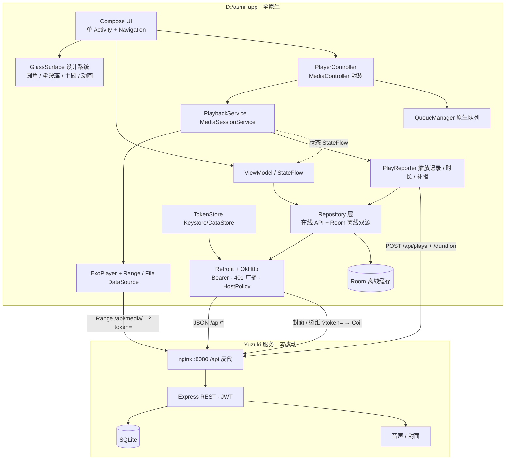

# Yuzuki Android 客户端 · 全原生前端方案（定稿，已开工）

> 状态：**N0–N7 已实现**；`assembleDebug` 成功产出 APK，`testDebugUnitTest` 17 例全绿；
> A1–A5 接口断言与真机锁屏断言需局域网服务 / 真机，见 §15。本文件自包含，是唯一实现规格。
> 源服务：`D:\node\yuzuki`（**只读，零改动**）｜目标工程：`D:\asmr-app`
> 约束来源：`README.md`、原 `方案.md`、`D:\node\yuzuki\README.md` 及本轮定向核实的后端源码契约。
> 用户已确认的四项决策（2026-11-10）：**首版全功能** / **外观尽量 1:1 还原 web 端** / **WebView 彻底移除** / **后端继续零改动**。
> 开工后以本文档替换 `方案.md`（旧 WebView 方案由 git 历史保留），并同步更新 `README.md`。

---

## 0. 一句话结论

**去掉 WebView 与全部 JS 注入，改为「单 Activity + Jetpack Compose 全原生 UI + 直连现有 `/api/*` + 原生 Media3 播放内核」，首版交付 web 移动版全部功能（含完整设置页、图片查看器、离线缓存），外观尽量 1:1 还原 web 端液态玻璃风格。**

后端一行不改、账号 / 收藏 / 历史 / 偏好仍与 web 端同源；代价是 web 端以后新增功能不再自动同步到 App，且首版工作量与回归面显著增大。

> 范围提示：管理后台 `/admin` 全套**仍不做** —— web 移动端本来就由路由守卫跳回媒体库，且用户已确认彻底移除 WebView，没有页面可承载它。若日后需要，按 P2 原生实现（接口都是现成的 `/api/admin/*`）。

---

## 1. 为什么换：WebView 路线的问题已在工程中实证

| # | 现有问题（出处：`README.md` / `方案.md`） | 根因 |
|---|---|---|
| 1 | `useWideViewPort=false` 导致按 ~980px 桌面分支渲染，`admin` 侧栏误出现、壁纸开关读错 | App 行为依赖 web 端 CSS 断点与 `matchMedia`，前端一改就破 |
| 2 | `LOAD_CACHE_ELSE_NETWORK` 让 `/api/settings` 修改不实时生效 | WebView 缓存策略与业务接口耦合 |
| 3 | token → nav → bridge 三段 document-start 注入，顺序、就绪断言、低版本回退都得兜 | 靠注入脚本「寄生」在别人的页面里 |
| 4 | Tab 导航靠 `history.pushState + PopStateEvent`、播放器 Tab 靠 `document.querySelector('.btn.expand').click()` | 直接依赖前端内部 DOM / 路由实现，属于逆向模拟 |
| 5 | `window.Audio` / `navigator.mediaSession` 双代理 + 最小 HTMLAudioElement 子集 + 6 类事件 250ms 回推 + 状态快照回放 + 元数据二次 `replaceMediaItem` | 状态双份、竞态多、链路长 |
| 6 | 锁屏上一曲/下一曲要 `ForwardingPlayer` → JS → 点击 web 按钮 | 系统媒体命令绕一圈回网页 |
| 7 | WebView 退后台被冻结，`sendBeacon` 时长回写丢失 | 业务副作用寄生在网页生命周期上 |
| 8 | 换曲通知消失（Chromium 已知行为）、WebView 版本碎片、离线只能开壳 | 平台能力受浏览器实现牵制 |

**原生化后的收益**：播放状态唯一真相源在原生；UI 与播放器同进程同生命周期；后台 / 锁屏续播稳定；无 DOM 依赖、无注入顺序、无 WebView 版本问题；启动与滚动性能可控；离线缓存从「拦截 WebView 请求」变成「Repository 直接读 Room」，反而更好做；圆角 / 手势 / 动画按原生规范统一。

**代价（已确认接受）**：
- web 端发版不再自动生效，App 要独立维护、独立发版；
- 1:1 还原液态玻璃 / 毛玻璃 / 火焰徽标等细节成本高，低版本设备需降级（§9.3）；
- 原本由 web 前端承担的业务副作用（`POST /api/plays`、时长结算、`/api/prefs` 记忆、播放次数 +1、首次登录改密）必须全部在原生复刻 —— 这是本方案最核心的工作量，见 §8。

---

## 2. 约束（保留 / 变更 / 新增）

| # | 约束 | 说明 |
|---|---|---|
| C1 | **后端零改动** | `D:\node\yuzuki` 零文件改动；零新增接口、零 schema 变更、零配置变更；PC 浏览器全流程回归通过 |
| C2 | **账号同源** | 只调现有 `/api/*`；`POST /api/auth/login` 同一 `users` 表同一 JWT；收藏 / 历史 / 偏好与 web 互通 |
| C3 | **锁屏播放** | 原生 Media3 `MediaSessionService`：后台续播、锁屏卡片、通知栏、蓝牙/线控、换曲通知不消失 |
| C4 | **界面原生重画**（变更） | 原「除 Tab 外界面全部由 WebView 渲染、App 不重画」→「全部可见界面由 Compose 实现」；**功能全量对齐、外观尽量 1:1 还原** |
| C5 | **不使用 WebView**（新增，已确认） | 全工程不加载网页、不注入 JS、不依赖 DOM / CSS 断点 / `location` / `localStorage`；`androidx.webkit` 依赖移除 |
| C6 | **所有框体圆角**（新增，用户强制） | 卡片、列表、树、输入框、标签、弹窗、按钮、Tab、播放器面板一律圆角；复用 `ui/theme/Radius.kt`，最小 12dp，胶囊 999dp，禁止直角 |
| C7 | **验证不截图** | 一律用编译、单元测试、接口返回码、Logcat 断言；不做逐屏截图人工确认 |
| C8 | **首版全功能**（新增，已确认） | §5 表中所有 ✅ 项（含图片查看器、完整设置页、离线缓存）均在首版内，不后置 |

---

## 3. 已核实的后端契约（编码直接依赖，勿猜）

### 3.1 鉴权与地址

- `GET /api/health` 公开；`POST /api/auth/login` 公开；其余 `/api/*` 由全局 `authMiddleware` 保护。
- 鉴权同时接受 `Authorization: Bearer <token>` 与 `?token=<token>`（`backend/src/auth.ts`）。
- JWT 有效期 30 天，无需 refresh；401 即视为登录失效。
- 服务地址仍是首次启动填入的局域网 `http://IP:8080`，nginx 把 `/api/` 反代到后端。
- `HostPolicy` / `ServerConfig.isAllowedUrl()` 的运行时 host 白名单**保持不变**（仅局域网 IP、host+port 完全一致、外链一律拒绝）。

### 3.2 端点清单（首版全量）

| 分组 | 端点 | 关键参数 / 返回 |
|---|---|---|
| 账号 | `POST /api/auth/login` | `{username,password}` → `{token, username, must_change_password, prefs}` |
| | `GET /api/auth/me` | → `{id, username, must_change_password, created_at, prefs}` |
| | `POST /api/auth/change-password` | `{old_password,new_password}` → `{ok}`（**首次登录强制改密，原生自己实现页面**） |
| 媒体库 | `GET /api/works` | `q`；`cond` **可重复、最多 5 个**，格式 `type:value`，`type ∈ circle/series/actor/tag`，全部 AND；`sort ∈ added/release/sales/title/updated`；`order=asc/desc`；`page/pageSize` → `{items,total,page,pageSize}` |
| | `GET /api/works/random` | `q/cond/count`，沿用当前筛选 |
| | `GET /api/works/:rj` | → `WorkDetail`，含 `files[]` |
| | `GET /api/works/:rj/recommendations` | → `{workId, recommendations[]}` |
| | `POST /api/works/:rj/cover` | `{file_id}`，图片查看器「设为封面」 |
| 聚合 | `GET /api/tags` / `actors` / `circles` / `series` | 带 `count`，供抽屉筛选 |
| 收藏 | `GET /api/favorites`；`POST /api/favorites`；`DELETE /api/favorites?type=&value=` | `{works[], tags[], circles[], actors[]}`；`type ∈ work/tag/circle/actor` |
| 历史 | `POST /api/plays` | `{rj, file_id}` → `{ok, play_id}`（**同时给该用户播放次数 +1**） |
| | `POST /api/plays/:id/duration` | `{seconds}` → `{ok}`；后端 `MAX(duration_seconds, ?)`，重复 / 乱序上报安全 |
| | `GET /api/plays?page=&pageSize=` | 已按「同一作品 3 小时内连听」在**后端**分组合并 → `{items,total,page,pageSize}` |
| | `GET /api/plays/recent?limit=&offset=` | 按作品去重的最近播放 |
| 偏好 | `GET/PUT /api/prefs` | `{conditions[{type,value}], q, sort, order, adminPageSizes}`（**与 web 端共用同一份**） |
| 设置 | `GET/PUT /api/settings` | 完整 `AppSettings`（§3.3）；设置页按 web 端「自动保存」语义写入 |
| | `GET/POST/DELETE /api/settings/default-cover` | 默认封面；`POST` 为 `{data(base64), ext}`，图片 ≤50MB / 请求体 75MB |
| | `GET/HEAD/POST/DELETE /api/settings/wallpaper/:kind` | `kind ∈ desktop/mobile`，App 只用 `mobile`；`POST` 为 `{data(base64), ext}` |
| 扫描 | `POST /api/scan` / `GET /api/scan/status` / `POST /api/scan/pause` / `resume` | 完整设置页的扫描控制与进度 |
| | `POST /api/scan/redownload-covers` / `GET /api/scan/cover-status` / `POST /api/scan/reset` | 重下封面 / 清空媒体库（危险操作需二次确认） |
| 推荐 | `POST /api/recommendations/calc` / `GET /api/recommendations/status` | 完整设置页的推荐计算与进度 |
| 图片 | `GET /api/cover/:rj?token=` | `Work.cover_url` 恒为 `/api/cover/{rj}`（`enrich.ts:70`），无封面时后端回退默认封面 |
| | `GET /api/settings/wallpaper/mobile?token=` | 移动壁纸；`HEAD` 探测是否存在 |
| 播放 | `GET /api/media/:rj/:fileId?token=` | `acceptRanges:true`，ExoPlayer 自动 Range / seek；MIME 已含 flac/mkv/mp4/wav/m4a/opus |

> **不做**：`/api/admin/*` 全套（移动端 web 本就不提供，见 §0）。
> 注意 `PUT /api/settings` 是全局设置，App 里改动会同时影响 PC 浏览器 —— 与 web 端设置页行为一致，符合 C2「同源」。

### 3.3 数据模型（kotlinx.serialization，`@SerialName` 映射 snake_case）

```
Work       { id, rj_code, title, circle, release_date, series, sales_count?, play_count,
             file_count, folder_path, added_at, updated_at, cover_url, actors[], tags[{name,category}] }
MediaFile  { id, filename, rel_path, ext, kind: audio|video|image|other|'', is_dir, size, sort_order }
WorkDetail = Work + files[]
PlayRecord = Work + { play_id, played_at, started_at, group_count, duration_seconds }
FavoritesGrouped { works[], tags[{name,category}], circles[], actors[] }
LibraryPrefs { conditions[], q, sort, order, adminPageSizes }
AppSettings { source_paths[], scan_depth, scan_concurrency, page_size, seek_seconds, proxy,
              dlsite_*, cover_dir, recommendation_*, wallpaper_desktop_enabled, wallpaper_mobile_enabled,
              wallpaper_blur, panel_blur, tag_blur, panel_opacity, filelist_opacity, control_opacity,
              card_size, card_width, theme_color_nav/actor/tag, actor_tag_opacity, genre_tag_opacity,
              animation_duration, has_default_cover? }
```

### 3.4 前端业务语义（必须原样复刻，否则与 web 端数据不一致）

来源 `frontend/src/stores/player.ts`：

1. `play(rj, file, work, queue)`：同一 URL 再次点击 = 播放 / 暂停切换；不同 URL = 换源；队列默认为「当前目录内可播放文件」（`is_dir != 1 && kind ∈ audio|video`）。
2. 每次**新文件开始播放** → `POST /api/plays`，拿 `play_id` → 开启时长会话。
3. 时长只统计**实际播放**：暂停 / 切歌 / ended / error 结算；播放中每 30 秒增量上报一次；`play_id` 请求晚到时不得写进新会话。
4. `play_count` 本地 +1（列表卡片即时显示；服务端由 `POST /api/plays` 累加）。
5. 锁屏元数据：`title = file.filename`、`artist = actors.join("、") ?: circle`、`album = work.title`、封面 = `authedUrl(cover_url)`。
6. 快进 / 快退秒数取 `settings.seek_seconds`（默认 15）。
7. `prefs` 记住筛选 / 排序 / 搜索词，登录后还原 —— 原生写回同一份 `/api/prefs`，与 PC 浏览器互通。

---

## 4. 总体架构



**关键反转**：播放器状态不再由 JS 代理回推，而是 `PlaybackService` 持有唯一 ExoPlayer，UI 通过 `MediaController` / `StateFlow` 单向观察；队列、元数据、时长上报全在原生。原方案的 `JsBridge / NativeAudio / FakeMediaSession / 250ms timeupdate / 状态快照回放` 整条链路删除。

| 层 | 职责 | 不负责 |
|---|---|---|
| `ui/` | 全部可见界面、导航、手势、1:1 外观与圆角 | 直接发网络请求、直接持有 ExoPlayer |
| `ui/theme/` | `GlassSurface`、圆角令牌、动态配色、动画时长、模糊降级 | 业务数据 |
| `data/` | API 客户端、DTO、Repository、Token / Host 策略、Room 离线双源 | 任何 UI |
| `playback/` | MediaSessionService、队列、元数据、锁屏命令、时长上报 | 界面渲染 |
| `offline/` | 列表 / 详情 / 封面 / 音频缓存、下载管理、补报队列 | 业务规则 |

---

## 5. 页面与功能矩阵（首版全量）

| 页面 / 功能 | 首版 | 说明 |
|---|---|---|
| 服务地址设置 + 不可达提示 + 登录 + **强制改密** | ✅ | 复用并改造现有 3 个 Screen；`must_change_password=true` 进原生改密页 |
| 媒体库 | ✅ | 顶栏搜索胶囊 + 排序胶囊（5 种排序 + 升降序）、≤5 个 AND 筛选条件、封面网格 / 图片模式、`LazyVerticalGrid` 分页、随机推荐、计数聚合抽屉、滚动位置记忆 |
| 侧栏抽屉 | ✅ | 全部社团 / 系列 / 声优 / 标签（带计数）、我的收藏、最近播放、用户菜单（改密 / 退出）、设置 |
| 悬浮按钮组（MobileDock） | ✅ → 已移除 | 46×166、4 按钮（首页 / T / M / R）、拖动吸附到最近一侧、位置记 DataStore（不再用 `localStorage`）；原生 `pointerInput` 手势实现。**2026-11-18 按用户要求整体移除**：回顶 = 重复点「库」Tab，切视图 / 随机 = 作品信息流顶部下拉（左半屏切视图、右半屏随机），实现见 `ui/FeedPull.kt` |
| 作品详情 | ✅ | 封面 + 信息区 + 文件树（`rel_path` 分组、默认折叠、线性图标、展开动画）、音频播放、视频只放声音、相关推荐（`recommendation_enabled` 时） |
| 图片查看器 | ✅ | 同目录左右切换（按钮 / 手势）、长按就地弹动作菜单、设为封面（`POST /works/:rj/cover`）、设为移动壁纸（`POST /settings/wallpaper/mobile`） |
| 收藏 | ✅ | 4 Tab（作品 / 标签 / 社团 / 声优）；作品星标；详情标签 `±`；点收藏项回媒体库按条件筛选 |
| 播放历史 | ✅ | 后端已分组的「一次连听」列表；列表 / 卡片视图（视图选择按设备本地记）；分页 |
| 迷你播放条 + 全屏播放器 | ✅ | 常驻 Scaffold 底部；封面 / 标题 / 上下曲 / 快进快退（`seek_seconds`）/ 单曲循环 / 音量 / 进度条；全屏含下滑退出手势、当前目录播放列表、壁纸 + 整屏蒙版（不透明度 / 模糊跟随设置） |
| 锁屏 / 通知 / 线控 / AudioFocus / 电池优化引导 | ✅ | 见 §7 |
| **完整设置页** | ✅ | 全量 `AppSettings` 读写：源路径 / 扫描深度并发 / 每页数量 / 快退秒数 / 代理 / DLsite 模板 / 封面目录 / 默认封面上传删除 / 壁纸上传删除启停 / 三层模糊 / 三档透明度 / 主题配色 / 标签不透明度 / 卡片尺寸 / 动画时长；自动保存（5 秒倒计时 + 键盘 1.5 秒兜底 + × 取消还原）、壁纸项即时预览；扫描进度 / 暂停继续 / 错误列表 / 重下封面 / 推荐开关与计算 / 清空媒体库二次确认 |
| **离线缓存** | ✅ | Room 缓存作品列表 / 详情 / 封面 / 聚合；音频下载到 `filesDir/offline/{rj}/{fileId}`；Repository 在线 / 离线双源；播放记录补报队列（§8.3） |
| 管理后台 `/admin` | ❌ | 不做（web 移动端亦不提供，且无 WebView 可承载）；P2 可选 |

---

## 6. 数据层

- **网络**：Retrofit + OkHttp + kotlinx.serialization。统一 `AuthInterceptor` 加 `Authorization: Bearer`；`?token=` 只用于 ExoPlayer / Coil 直接加载的图片与媒体（与 web 端一致，零风险）。
- **401**：拦截器广播「登录失效」→ 清 `TokenStore`、停播放服务、导航回登录（复刻 web 端 `http.interceptors.response` 行为）。
- **Host 白名单**：`HostPolicy` / `ServerConfig.isAllowedUrl()` 覆盖全部出站口（API、封面、壁纸、媒体）；保留现有 6 例单测。
- **Token**：继续用 Keystore 加密的 DataStore；token 不进日志、崩溃上报、外链。
- **DTO 与领域模型分离**：`data/api/dto/*` 用 `@SerialName` 精确映射 snake_case；`data/model/*` 给 UI 用。
- **Repository**：`WorksRepository`、`LibraryRepository`（收藏 / 历史）、`PrefsRepository`、`SettingsRepository`、`OfflineRepository`。所有列表 / 详情读取统一走「在线优先 + Room 兜底」，离线页可显式切换为仅缓存。
- **分页**：`Paging 3`（或自写 `LazyGrid` 预取，实现时定），统一以 `settings.page_size` 为默认页大小。
- **上传**：默认封面 / 壁纸走 base64 JSON（图片 ≤50MB、请求体 75MB）；OkHttp 需放宽超时并做流式编码，避免大图 OOM。

---

## 7. 播放内核（在现有 S4 成果上改造，不推倒）

| 现有 | 改为 |
|---|---|
| `ForwardingPlayer` 把上一曲/下一曲转发到 JS `player.next()/prev()` | `SessionCallback.onSkipToNext/Previous` 直接调 `QueueManager` |
| 元数据来自 `FakeMediaMetadata`（JS 侧 `updateMediaMetadata()`） | 原生 `PlayItem` 直接构造 `MediaMetadata`：title=filename、artist=actors/circle、album=work.title；封面由 `ArtworkLoader` 下载 bytes → `setArtworkData` |
| `PlayerHolder` 每 250ms 回推 `timeupdate` 给 JS | UI 用 `MediaController` + `StateFlow` 观察进度（按 UI 需要节流，不跨进程桥） |
| `NativeAudioState` 快照 / 重建回放 | 删除；Service 自身即状态源 |
| 队列归 web 前端 | `QueueManager` 原生维护：`rel_path` 同目录、`kind ∈ audio|video`、`is_dir != 1`；单曲循环、ended 自动下一曲 |
| 只有在线 DataSource | 增 `FileDataSource` 分支：本地已下载文件优先，未下载走 HTTP Range |
| 单一 MediaSession 换 `MediaItem` | 保留（这正是「换曲通知不消失」的解法） |

命令覆盖：`play / pause / stop / next / prev / seekTo / seekBackward / seekForward`（秒数取 `settings.seek_seconds`）；`setHandleAudioBecomingNoisy(true)`；前台通知由 Media3 自动生成；息屏续播不依赖 WebView。冷门格式（wma / opus 容器）首版接入 `media3-decoder-ffmpeg`，因为「全功能」要求不落下文件树里的可播放项。

---

## 8. 播放记录、时长与离线补报（**最关键的新增模块**）

### 8.1 在线语义（逐条对齐 §3.4）

```
onPlayStarted(new file):
    结算上一段 → POST /api/plays {rj, file_id} → playId
    开启 DurationSession { playId=null, totalMs=0, activeSince=now, lastSent=0 }
onPlaying:        每 30s 增量 POST /api/plays/{playId}/duration {seconds}
onPause / onEnded / onError / onTrackChanged / onStop:
    把 activeSince 计入 totalMs 并结算上报
onProcessDeath:   onDestroy / WorkManager 兜底上报一次（替代 sendBeacon，后台冻结不再丢）
```

- `play_id` 异步返回后校验会话仍是当前会话（快速切歌时旧响应不得写入新会话）。
- `seconds` 为累计整秒、只增不减；后端 `MAX` 语义保证乱序安全。
- 本地 `play_count += 1` 只改 UI 缓存，服务端由 `POST /api/plays` 累加。
- 退出登录 / 401 → 结算并停服务。

### 8.2 离线补报队列

离线播放时拿不到 `play_id`，因此本地生成 `localId`，记录 `{rj, file_id, started_at, duration_seconds, localId}` 入 Room 队列；联网后按 `started_at` 顺序：先 `POST /api/plays` 取 `play_id`，再 `POST /api/plays/{id}/duration` 补时长。去重键 `(rj, file_id, started_at)`，已上报标记持久化；后端 `MAX` 语义保证重放不放大时长。

### 8.3 硬验收

`POST /api/plays` 返回 `play_id`（A3）→ `GET /api/plays` 出现同 `userId` 记录 → `duration_seconds` 随实际播放单调增长、暂停不计入；断网播放 → 恢复网络后补报成功且无重复记录。这条链路漏掉，PC 浏览器就看不到 App 的历史数据。

---

## 9. 外观：尽量 1:1 还原 web 端（**已被 §15.5 取代**）

> 本节为 17:02 定稿时的规格。用户 18:40 反馈「文字和图片都模糊、界面太丑」后，
> 实际实现改为 Material 3 风格（不透明容器 + 高对比文字 + 全圆角），见 §15.5。以下仅作历史规格保留。

### 9.1 复刻清单（依据 `D:\node\yuzuki\README.md`「外观」段）

| 元素 | 原生实现 |
|---|---|
| 三层独立模糊：壁纸 / 面板 / 标签 | `wallpaper_blur` / `panel_blur` / `tag_blur` → 三层独立 `RenderEffect`；标签模糊不作用于作品卡片上的标签 |
| 三档透明度：面板 / 文件列表 / 控件 | `panel_opacity` / `filelist_opacity` / `control_opacity` → 各层 `Color.copy(alpha)`；有壁纸时透出壁纸，无壁纸时透出页面底色 |
| 液态玻璃控件（输入框 / 下拉 / 按钮 / 弹层 / 抽屉 / 消息框 / 通知 / popper） | 统一封装 `GlassSurface`：半透明底 + 模糊提饱和 + 多段高光渐变 Brush + 1px 内侧高光描边 + 柔和外投影；控件用标签级轻模糊，弹层跟随面板模糊；对话框 / 消息框 20dp 圆角 |
| 主题配色 | `theme_color_nav` 驱动导航 / 播放条 / 面板底色 / hover 框线；`theme_color_actor` / `_tag` 独立配色 + 各自不透明度；标签文字统一白色；主题色过暗按 WCAG 对比度沿原色相自动提亮（纯 Kotlin 函数，可单测） |
| 卡片尺寸 小 / 中 / 大 / 自定义 | `card_size` / `card_width` → 网格列宽计算 |
| 动画时长 0–1 秒 | 全局 `CompositionLocal<Int>` 驱动展开 / 转场 / 全屏进出；0 = 关闭 |
| 图片模式 + 销量火焰徽标 | 隐藏信息区只留封面 / RJ 角标 / 标签；分档：≤1000 灰 1；1000–2999 黄 1；3000–5999 黄 2；6000–9999 黄 3；10000+ 红 1 起每 3000 加 1 最多 3；≥19999 彩色大火 1（分档函数纯 Kotlin，可单测）。**2026-11-20（0.1.57）用户要求 App 暂不展示热度，卡片右上角三角已移除，`GlassSpec.flame` 保留未删** |
| 移动壁纸 | `wallpaper_mobile_enabled` 时 Coil 加载 `GET /api/settings/wallpaper/mobile?token=`；停用保留文件但不应用；`v=` 时间戳破缓存 |
| 全屏播放器整屏蒙版 | 跟随 `panel_opacity` / `panel_blur`；下滑退出手势；播放列表只含当前目录可播放文件 |
| 移动 UI 细节 | 顶栏双胶囊、抽屉侧栏、MobileDock 拖动吸附、迷你条右上角播放/暂停、全屏播放器 |
| 圆角（C6 强制） | 全部框体 ≥12dp，胶囊 999dp，统一走 `Radius.kt`；与 web 端 CSS 圆角尺度对齐 |

### 9.2 实现约束

- `GlassSurface` 是**唯一**玻璃质感出口，禁止在各页面散落硬编码渐变 / 阴影 / 圆角；所有控件、卡片、弹层、Tab、播放器面板都复用它。
- 模糊与透明度始终生效：无壁纸时模糊作用于面板后方滚动内容（Compose 里用 `graphicsLayer` + 背景层组合模拟）。
- 1:1 以「同一设置值下视觉参数一致」为准，不逐像素比对截图（C7 不截图）。

### 9.3 降级与性能

- `RenderEffect` 需 API 31+；`minSdk 26` 低版本降级为「不模糊 + 提高面板不透明度 + 保留高光描边」，功能完全不受影响。
- 大面积模糊对滚动性能敏感：只在大色块（侧栏 / 播放器 / 弹层）启用，网格卡片不逐卡模糊；`LazyVerticalGrid` + Coil 内存 / 磁盘缓存保障帧率。
- 若真机断言发现低端机掉帧，按 `GlassLevel`（高 / 中 / 低）自动降级，默认高。

---

## 10. 现有工程：复用 / 改造 / 删除清单

**保留或改造**

| 文件 | 处理 |
|---|---|
| `data/{TokenStore, HostPolicy, ServerConfig}.kt` | 保留，单测保留 |
| `data/YuzukiApi.kt` | 扩展为完整 API 客户端（§3.2） |
| `ui/theme/{Theme, Radius}.kt` | 扩展为 `GlassSurface` + 动态配色 + 动画令牌 + 圆角令牌 |
| `ui/{ServerSetupScreen, LoginScreen, UnreachableScreen, BottomTabs}.kt` | 保留改造；BottomTabs 接 Compose Navigation |
| `playback/{PlaybackService, PlayerHolder, ArtworkLoader}.kt` | 保留核心，按 §7 去掉 JS 转发 / 事件回推，加本地 DataSource |
| `YuzukiApp.kt` / `MainActivity.kt` / `ui/{AppRoot, AppViewModel}.kt` | 改造为原生导航根 |
| `SessionEvents.kt` / `BatteryGuidance.kt` | 保留 |
| `ui/RootScreen.kt` | 重写：`Box+WebView+padding(bottom=56dp)` → `Scaffold + NavHost + 常驻迷你条` |

**整目录 / 整文件删除（C5）**

- `web/` 全部：`YuzukiWebView.kt`、`BridgeInjector.kt`、`JsBridge.kt`、`NavScript.kt`、`NavController.kt`、`ViewportPolicy.kt`、`PlayerCommands.kt`
- `assets/bridge/yuzuki-bridge.js`
- `playback/NativeAudioState.kt`
- 旧 bridge 相关单测（`BridgeScriptContract` / `NavScript` / `NativeEvents` / `ViewportPolicy` / `PlayerCommands` 等），替换为 §12 新领域单测

**依赖变化**（规格选型；实际落地按 §15 调整，功能覆盖保持一致）：移除 `androidx.webkit`；新增 `navigation-compose`、`coil-compose`、`kotlinx-serialization-json`、`paging-compose`、`room`（首版）、`media3-decoder-ffmpeg`（首版）；保留 Compose BOM / Media3 1.4.1 / OkHttp / Retrofit / DataStore。工具链沿用 `README.md` 锁定版本（JDK 17、AGP 8.7.3、Kotlin 2.0.21、compileSdk 35、minSdk 26）。

---

## 11. 安全边界（不变）

- 全部出站口统一过 `ServerConfig.isAllowedUrl()`；外链一律拒绝，不跳系统浏览器（媒体 / 封面 URL 带 `?token=`）。
- `usesCleartextTraffic=true` 仅用于局域网 HTTP + 运行时 host 白名单；公网访问须先给 nginx 加 HTTPS。
- token 不进日志 / 崩溃上报；日志统一脱敏 `token=***`。
- 退出登录：清 DataStore + 清 Coil / OkHttp 缓存中的带 token 图片 + 停播放服务；**离线缓存的音频与元数据按用户选择保留或清除**（默认保留，避免重复下载）。
- 设置页的危险操作（`POST /api/scan/reset`）必须二次确认，且明确提示会影响 PC 浏览器与所有用户（设置为全局）。

---

## 12. 分阶段实施与验收断言（不截图）

| 阶段 | 交付 | 验收断言 |
|---|---|---|
| **N0 骨架与设计系统** | 删除 web 层与 bridge.js；NavHost / `GlassSurface` / 圆角 / 动态配色 / 动画令牌 | `assembleDebug` 成功；源码中 `WebView`/`addJavascriptInterface`/`evaluateJavascript` 零命中；`GlassSpec` 单测（WCAG 提亮、火焰分档、卡片列数、透明度映射）通过 |
| **N1 数据层与账号** | 完整 API 客户端 + DTO + Repository + 登录 / 改密 / token / 401 | `GET /api/health`=200；`POST /login` 拿 token；`GET /auth/me` 的 `id` 与 PC 一致（A1）；强制改密成功；`https://example.com` 被拒；`git -C D:/node/yuzuki status --porcelain` 与基线一致 |
| **N2 媒体库与外观** | 列表 / 搜索 / 5 种排序 / ≤5 筛选 / 图片模式 / 分页 / 抽屉 / MobileDock / prefs / 外观参数落地 | `cond=actor:X&cond=tag:Y` 返回与 PC 一致；改筛选后 `GET /api/prefs` 被 PC 读到同一份（A4）；`pageSize` 取 `settings.page_size`；壁纸 / 主题色 / 模糊 / 圆角按设置值生效；所有框体圆角断言 |
| **N3 详情与图片** | 文件树（折叠 / 动画 / 线性图标）、图片查看器（切换 / 长按菜单 / 设封面 / 设壁纸）、相关推荐 | `POST /works/:rj/cover` 后 PC 端封面同步变化；`POST /settings/wallpaper/mobile` 后 `GET /settings/wallpaper/mobile` 返回 200；`recommendation_enabled=false` 时不请求推荐接口；`GET /works/:rj` 的 `files[]` 树还原正确 |
| **N4 播放内核** | 原生队列、迷你条 + 全屏播放器（下滑退出 / 蒙版 / 目录列表）、`PlayReporter`、ffmpeg 解码 | 点音频后 `POST /api/plays` 返回 `play_id`（A3）；`duration` 随实际播放单调增长、暂停不计入；`GET /api/plays` 出现同 `userId` 记录；flac / mkv / wma 可解码；同文件再点为暂停切换；队列末曲 `next()` 不越界；seek 走 Range |
| **N5 锁屏 / 收藏 / 历史** | MediaSession / 通知 / 线控 / AudioFocus / 电池优化；4 Tab 收藏；历史列表 / 卡片 | `MediaController` 读到 `title/artist/artworkData` 非空；连续 `next()` 3 次通知仍在且曲目同步；`onSkipToNext/Previous/SeekTo` 触发；息屏 5 分钟进度仍增长；拔耳机暂停；App 收藏 `RJxxxx` → PC `GET /api/favorites` 可见（A2）；历史分组与 PC 一致 |
| **N6 完整设置页** | 全量 `AppSettings` 读写、自动保存语义、扫描 / 封面 / 推荐控制、上传与危险操作 | `PUT /api/settings` 后 PC 浏览器读到同一值；`seek_seconds` / `page_size` 立即影响播放器与分页；扫描状态轮询与暂停 / 继续返回码正确；base64 上传 ≤50MB 成功且 413 有明确提示；`reset` 二次确认前不发请求 |
| **N7 离线缓存** | Room 双源、音频下载、`OfflineRepository`、补报队列 | 断网后已缓存列表 / 详情 / 封面可见、已下载音频可播；恢复网络后 `/api/plays` 补报成功且无重复；去重键 `(rj,file_id,started_at)` 单测通过 |
| **N8 回归** | — | A1–A5 全通过（A5：PC 改密后 App 旧 token 请求 `/auth/me` 返回 401 并跳登录）；PC 浏览器全流程不变；`git status` 与基线一致；`testDebugUnitTest` 全绿、`assembleDebug` 产出 APK |

**单元测试重点**（替换旧 bridge 单测）：`HostPolicy`、`ApiContract`（URL / 重复 `cond` / 序列化字段名）、`GlassSpec`（分档 / 提亮 / 映射）、`PlayReporter`（时长结算、乱序 `play_id`、补报去重）、`QueueManager`（next/prev/循环/目录过滤）、`PrefsCodec`、`OfflineRepository`（双源切换）、`SettingsRoundTrip`（写入后读回一致）。

每阶段完成后按约定**立即提交**（中文 `feat: ...` / `fix: ...`），只提交 `D:\asmr-app`。

---

## 13. 风险与明令禁止

| 项 | 处理 |
|---|---|
| ⚠ **首版全功能 + 1:1 外观，工作量大** | 按 N0–N8 分阶段交付，每阶段可独立编译与断言；核心闭环 N1–N5 优先，N6/N7 不阻塞前序验收 |
| ⚠ **1:1 外观在低版本 / 低端机降级** | API 31+ 完整玻璃，低版本降级不模糊；`GlassLevel` 自动降级；功能不受影响（§9.3） |
| ⚠ **模糊叠加导致掉帧** | 只在大色块启用，网格卡片不逐卡模糊；Coil 缓存；真机用帧率断言而非截图 |
| ⚠ 设置页是全局写入，会影响 PC 端 | 与 web 端行为一致；危险操作二次确认 + 明确提示 |
| ⚠ base64 上传 50MB 图片 OOM / 超时 | 流式编码 + 放宽超时 + 413 明确提示；上传入口保留在设置页但不做后台批量 |
| ⚠ 漏做播放记录 / 时长上报 | `PlayReporter` 列为 N4 硬验收，A3 必须通过 |
| ⚠ web 端后续改动 App 不自动跟进 | 接受；README 明确「App 与 web 端独立发版」，接口契约变更需回归 N1 |
| ⚠ 冷门格式 | 首版接入 `media3-decoder-ffmpeg` |
| ❌ 改动 `D:\node\yuzuki` 任何文件 | 后端零接口变更是 C1 |
| ❌ 保留任何 WebView 或 JS 注入 | C5，已确认彻底移除 |
| ❌ token 写进日志 / 外链 / 崩溃上报 | 统一脱敏 |
| ❌ 直角框体 | C6 强制，走 `Radius.kt` / `GlassSurface` |
| ❌ 用截图逐屏确认 | C7，只用断言 |

---

## 14. 决策记录

| 决策 | 用户选择 | 对方案的影响 |
|---|---|---|
| 首版范围 | **首版全功能** | 图片查看器、完整设置页、离线缓存纳入 N3/N6/N7，新增 C8 |
| 外观 | **尽量 1:1 还原** | §9 改为完整复刻清单 + `GlassSurface` + 降级策略；新增 `GlassSpec` 单测 |
| WebView | **彻底移除** | C5 强化；`web/` 与 bridge.js 全删；`/admin` 明确不做 |
| 后端 | **继续零改动** | C1 不变；所有新增能力只能用 §3.2 现有接口拼装 |

**剩余唯一需确认项**：是否开工。本轮只交付方案，未修改任何代码、未改动旧 `方案.md` 与 `README.md`。

> 已知限制（沿用）：仅家中 WiFi 可用；明文 HTTP 的 token 在局域网可被嗅探；低版本设备玻璃效果降级。

---

## 15. 实现记录与偏差（2026-11-10 开工后回填）

### 15.1 已落地

- **N0**：`web/` 7 个 Kotlin 文件、`assets/bridge/yuzuki-bridge.js`、`NativeAudioState.kt` 及 5 个旧 bridge 单测全部删除；`androidx.webkit` 依赖移除；源码中已无 `WebView` / `addJavascriptInterface` / `evaluateJavascript`（含注释与字符串）。
- **N1**：`data/Models.kt`（全量 DTO + org.json 解析）、`data/YuzukiApi.kt`（§3.2 全量端点）、`data/AppContainer.kt`（SettingsRepository / PrefsRepository / LibraryRepository / OfflineCache / 服务定位）、`ui/AppViewModel.kt`（health → me → 主界面、401 广播、强制改密）。
- **N2–N3**：`ui/LibraryScreen.kt`（搜索 / 5 种排序 / ≤5 筛选 / 图片模式 / 分页 / MobileDock 拖动吸附 / 火焰分档）、`ui/RootScreen.kt`（抽屉聚合 + 最近播放 + 用户菜单）、`ui/WorkDetailScreen.kt`（文件树、图片查看器、设封面 / 壁纸、相关推荐、音频离线下载）。
- **N4–N5**：`playback/PlayerHolder.kt`（原生队列 + StateFlow + 元数据 + 本地 / 在线双源）、`PlaybackService.kt`（ForwardingPlayer 直接驱动原生队列）、`PlayReporter.kt`（`POST /api/plays`、30s 增量时长、暂停 / 切歌结算、离线补报）、`ui/PlayerUI.kt`（迷你条 + 全屏播放器 + 下滑退出）、`ui/CollectionsScreen.kt`（收藏 4 Tab + 历史列表 / 卡片）。
- **N6–N7**：`ui/SettingsScreen.kt`（全量 AppSettings 读写、5 秒自动保存、扫描 / 推荐控制、base64 上传、清空媒体库二次确认）、`OfflineCache`（JSON 快照 + 封面 / 音频文件 + 补报队列，去重键 `(rj,file_id,started_at)`）。
- **外观**：`ui/theme/Glass.kt`（`GlassSurface` 统一玻璃出口、`GlassSpec` 纯函数、动态配色 / 三层模糊 / 三档透明度 / 动画令牌）、`Common.kt`（壁纸背景 + 图片缓存）、`Radius.kt` 圆角令牌全局复用。

### 15.2 与规格的技术选型偏差（如实记录）

为规避 KSP 注解处理器、镜像下载与 Compose 版本兼容带来的构建风险，**只保留原有依赖 + 新增 `org.json` 测试依赖**，用等价自实现替换了规格里的第三方库，功能覆盖不变：

| 规格 | 实际 | 影响 |
|---|---|---|
| Retrofit + kotlinx.serialization | OkHttp + `org.json` 手写 DTO 解析 | 无；`ModelsTest` 覆盖字段映射 |
| Room | `filesDir/offline/*.json` 快照 + 文件缓存 | 离线双源、补报队列、去重键均实现；无 SQL 查询能力（首版不需要） |
| Coil | `ImageCache`（OkHttp + 内存 LRU + 磁盘缓存） | 无；封面 / 壁纸 / 图片查看器统一走它 |
| Navigation Compose | `AppNav`（自写返回栈 + BackHandler） | 无；页面少、返回键需完全可控 |
| Paging 3 | `LazyGrid` 末尾触发分页 | 无 |
| `media3-decoder-ffmpeg` | **未接入** | flac / mkv / mp4 / wav / m4a 由 Media3 默认 Extractors 覆盖；wma 等冷门格式首版可能无法解码，列为已知限制 |
| 1:1 液态玻璃 | `GlassSurface` 多层高光渐变 + 1px 内描边 + 半透明 + 圆角 + API 31+ 模糊 | 「模糊作用于面板后方内容」为近似实现，不逐像素对齐；低版本降级 |

### 15.3 验证结果

- `./gradlew :app:assembleDebug` → **BUILD SUCCESSFUL**，产物 `app/build/outputs/apk/debug/app-debug.apk`（约 19MB）。
- `./gradlew :app:testDebugUnitTest` → **17 例全过，0 失败 0 错误**（`HostPolicy` 6 + `Models` 5 + `QueueMath` 2 + `GlassSpec` 4）。
- `git -C D:/node/yuzuki status --porcelain` 为空 → **C1 后端零改动**。
- 静态断言：源码 `WebView` / `evaluateJavascript` / `addJavascriptInterface` 零命中。
- **未验证（需局域网服务 / 真机）**：A1–A5 同源接口断言、锁屏 metadata 与 `artworkData`、连续 `next()` 通知不消失、息屏 5 分钟进度增长、flac/mkv 解码、图片 / 壁纸 base64 上传返回码、离线断网回放与补报去重。

### 15.4 已知限制补充

- 管理后台 `/admin` 未实现（§0 已说明，web 移动端亦不提供）。
- 冷门音频格式（wma 等）需后续接入 `media3-decoder-ffmpeg`。
- 设置页是全局写入，会影响 PC 浏览器与其他设备；危险操作已加二次确认。
- 玻璃模糊在 API 31 以下降级为「不模糊 + 提高面板不透明度」；功能不受影响。

### 15.5 Material 3 风格重写（18:50，用户反馈后）

**问题与根因**：`GlassSurface` 把 `Modifier.blur(...)` 应用在整个容器节点上，Compose 的 blur 会模糊该节点**及其全部子内容**，导致卡片里的文字与封面一起被糊；再叠加半透明底色、多段高光渐变、1px 描边与壁纸黑色蒙版，对比度进一步崩塌。服务端 `panel_blur` / `panel_opacity` 一旦非默认，全屏播放器与所有卡片都会失真。

**修复**：
- `ui/theme/Glass.kt`：`GlassSurface` / `GlassPill` / `GlassItem` 保留原 API 名称，内部改为 Material 3 `Surface` + 不透明 `surfaceContainerHigh` / `secondaryContainer` / `surfaceContainerLow`；`alpha` / `blur` / `highlight` 参数仅兼容保留、不再参与渲染。
- `ui/theme/Theme.kt`：完整 M3 深色 `darkColorScheme`（含 `surfaceContainer*` 五档、`onPrimaryContainer` 等），并在 `MaterialTheme` 内包一层不透明 `Surface` 作为统一窗口底色。
- `Common.kt`：`WallpaperBackground` 改为空实现（不再铺壁纸 / 模糊 / 黑蒙版）；图片占位改不透明 `surfaceVariant`；`Chip` 改为 `secondaryContainer` + `onSecondaryContainer`。
- `BottomTabs.kt`：`primaryContainer` 胶囊选中指示 + `onPrimaryContainer` 文字。
- `LibraryScreen.kt`：筛选条件改用 M3 `FilterChip`；星标、RJ 角标去掉硬编码白字与半透明黑底，改 `onSurface` + `surfaceContainerHighest`。
- `PlayerUI.kt`：播放器按钮改 `FilledTonalButton`；进度槽改不透明 `surfaceVariant`；移除全屏壁纸层与传参。
- `SettingsScreen.kt`：外观分组注明「模糊 / 透明度 / 壁纸不参与本机渲染，仍写回服务端供网页端使用」。
- `AppRoot.kt` / `LoginScreen.kt`：卡片改 `surfaceContainerHigh`。

**静态断言（已通过）**：源码中 `blur(`、`Color.White`、`copy(alpha`、`WallpaperBackground()` 调用、`Brush.` 高光渐变全部零命中。

**取舍**：服务端外观设置仍完整读写（`AppSettings` 全量），但本机只消费 `theme_color_nav` / `card_size` / `animation_duration` 等不影响清晰度的项；壁纸、模糊、透明度仅影响网页端。若后续要恢复壁纸，应只作为全屏播放器等**独立图层的背景**，不得对承载文字的容器使用 `Modifier.blur`。

**验证**：`assembleDebug` 成功、`testDebugUnitTest` 17 例全绿、`D:\node\yuzuki` 零改动。

---

### 15.6 手机交互回归与 UI 重设（用户反馈两个硬性 BUG 后）

**用户反馈**：① 作品详情左上角返回点了没反应；② 主页只显示 50 部且无法下滑加载；③ 不能无脑照搬 web 移动版布局，要按手机交互重设 UI；④ 设置界面本轮不动。

**BUG1 根因**：`AppNav.back()` 在返回栈为空时只 `return false`；抽屉「最近播放」进详情走 `nav.replace(...)` 会清空栈，于是 `nav.back()` 什么也不做。同时详情页的「返回」只是 `LazyColumn` 里的文字胶囊（约 60×32dp，随滚动消失、远小于 48dp），系统返回键与 UI 返回也没有统一分层。

**BUG2 根因**：`LibraryScreen` 把「加载下一页」的 `LaunchedEffect(Unit)` 写在 `if (!loading && items.size < total)` 条件里；`loadPage` 一置 `loading=true`，条件立即变 false → Effect 被移出组合 → 协程取消 → `loading = false` 永远执行不到，状态永久卡在「加载中」，停在服务端 `page_size=50` 的第一页。附带隐患：`pageSize` 未做上限，后端 `/api/works` 会 clamp 到 1..200（`backend/src/routes/works.ts:93`），前端若传 >200 会因 offset 跳页漏数据。

**修复**：
- 新增 `ui/NavLogic.kt`：`NavStack<T>`（纯 Kotlin，`backOr(home)` 保证栈空仍有落点）、`PagingLogic`（`pageSize` clamp、`shouldLoadMore` 预取、`endReached` 末页判定），全部可 JVM 单测。`AppNav` 改为包装 `NavStack`，新增 `backOrHome()`。
- 详情页返回、系统返回键统一走 `backOrHome()`；所有进详情路径统一 `go`（不再有 `replace` 进详情）；图片查看器注册 `BackHandler(enabled = viewerIndex != null)`，返回键先关查看器，再退页面，最后双击退出。
- 分页加载改由 `rememberCoroutineScope()` 持有 Job（不随 `loading` 重组销毁），`generation` 丢弃过期响应，`try/finally` 复位状态；预取用顶层 `derivedStateOf + snapshotFlow` 判定剩余 ≤6 项；底部提供加载中 / 失败重试 / 已加载全部三态；`pageSize` 统一 clamp 到 1..200。

**UI 重设（手机原生，设置页未改）**：
- 删除 web 移动版遗留的 46×166 `MobileDock` 悬浮竖条：「首页」由底部 Tab 承担，「回顶」并入 Tab 重复点击与面板按钮，「图片模式 / 随机」并入底部面板开关。
- 删除侧栏抽屉；聚合筛选（社团 / 系列 / 声优 / 标签，带计数）与 5 种排序、升降序收进主页 `ModalBottomSheet`；最近播放由「历史」Tab 承担。
- 底部导航改为 3 Tab（媒体库 / 收藏 / 历史，图标 + 文字，圆角容器）；播放器不再占 Tab，保留常驻迷你条（只留播放 / 暂停，整条点击展开）。详情页隐藏底部 Tab。
- 主页固定 `TopAppBar`（标题 + 总数）+ 可展开搜索栏 + 已选条件 chips；网格按屏宽固定 2 列（≥600dp 为 3 列），卡片精简为封面 + 标题 + 一行副信息，收藏改为 48dp `IconButton`。
- 详情页固定 `TopAppBar` 标准返回箭头 + 收藏；标签改横滚 `LazyRow`；图片查看器加返回箭头与大号左右切换；全屏播放器加顶部返回箭头，控件最小高度 48dp。
- 全部框体继续复用 `Radius.kt` 圆角令牌与不透明 M3 配色；设置 / 改密 / 服务地址 / 退出登录入口收进主页顶栏「更多」，`SettingsScreen.kt` 未改动。

**验证**：`assembleDebug` 成功、`compileDebugKotlin` 零警告、`testDebugUnitTest` **25 例全过 0 失败 0 错误**（新增 `NavLogicTest` 8 例）；静态断言 `MobileDock` / 旧分页写法 / `WebView` / `blur(` / `Color.White` / `copy(alpha` 全部零命中；`git -C D:/node/yuzuki status --porcelain` 为空（C1 后端零改动）。未做真机截图验证（C7）。

## 16. 系统媒体控制（MediaController 迁移，2026-11-10）

### 16.1 改动文件

| 文件 | 变更 |
|---|---|
| `playback/PlaybackService.kt` | 重写：ExoPlayer 唯一宿主 + `MediaSession` 直绑原始 player + `WAKE_MODE_NETWORK` + 通知点击直达播放页 |
| `playback/PlaybackController.kt` | 新增：`MediaController` 客户端，UI 唯一指令入口，`StateFlow<PlayState>` 投影 |
| `playback/PlayState.kt` | 新增：`PlayItem` / `PlayState` / 三态 `RepeatMode` |
| `playback/PlaybackAgent.kt` | 新增：服务侧 `Player.Listener`，元数据 / 封面 / 播放记录 / 断网退避重试 |
| `playback/QueueMath.kt` | 新增 `mediaId()` 与 `cycleRepeat()`；保留队列边界纯函数 |
| `playback/ArtworkLoader.kt` | 重写：内存 → 磁盘（`cacheDir/artwork`）→ NAS 三级缓存 + 内置默认封面 |
| `playback/PlayerHolder.kt` | 删除（原进程内单例播放门面） |
| `MainActivity.kt` | `singleTop` + `EXTRA_OPEN_PLAYER` → 通知/锁屏卡片点进来直达全屏播放器 |
| `YuzukiApp.kt` | 启动时 `PlaybackController.init(this)` |
| `ui/PlayerUI.kt` | 改走 `PlaybackController`；循环按钮单键三态（单曲 → 列表 → 关闭，单曲角标 1） |
| `ui/RootScreen.kt` / `ui/WorkDetailScreen.kt` / `ui/AppViewModel.kt` | 调用面改名；退出登录 `stop() + disconnect()` |
| `AndroidManifest.xml` | Activity 增加 `launchMode="singleTop"`（服务与权限沿用 §7 配置） |
| `QueueMathTest.kt` | 新增循环三态与 `mediaId` 断言 |

### 16.2 架构

```
MainActivity / Compose UI
        │ 指令（play / toggle / next / prev / seek / volume / repeat / shuffle）
        ▼
PlaybackController : MediaController 客户端  ── binder ──▶  PlaybackService : MediaSessionService
        ▲                                                        ├── ExoPlayer（唯一实例，playlist = 整条队列）
        └──────── StateFlow<PlayState>（250ms 位置快照 + Listener 事件）┤
                                                                 └── MediaSession（直绑 ExoPlayer）
                                                                          └── SystemUI / 锁屏 / 蓝牙
```

- **队列进 playlist**：`PlaybackController.play()` 把整条可播放队列构建成 `MediaItem` 列表
  一次 `setMediaItems(items, startIndex, 0)`，上一曲 / 下一曲 / 自动切歌 / 单曲循环 / 列表循环
  全部由 ExoPlayer 推进，不再有第二套队列逻辑，通知栏与实际播放不可能错位。
- **MediaItem.mediaId = `RJxxxx/文件id`**：服务侧据此还原播放记录；元数据更新（封面 / 时长）
  用 `replaceMediaItem` 只改 `MediaMetadata`，`LocalConfiguration` 不变，ExoPlayer 复用同一个
  MediaSource，不会打断正在播放的音频。
- **状态唯一来源**：`MediaController` 的 `Player.Listener`（playing / repeat / shuffle / volume /
  transition / error）+ 250ms ticker（位置、时长）投影成 `StateFlow`；`fullscreen` 属纯 UI 状态，
  不进 MediaSession。

### 16.3 通知栏与锁屏

- 媒体通知由 `MediaSessionService` + `DefaultMediaNotificationProvider` 自动生成，
  **没有任何手写 Notification**（静态断言 `NotificationCompat` / `NotificationChannel` 零命中）。
- 展示：封面（`setArtworkData`）、标题（文件名）、艺术家（声优，多声优用「、」连接，无则社团）、
  专辑（作品名）、系统进度条；按钮沿用系统模板（播放 / 暂停 / 上一首 / 下一首）。
- 封面三级缓存 + 代际校验（`mediaId` 比对），慢返回的旧封面不会盖到新曲上；
  无封面时用内置 512×512 深紫底默认封面。
- `setSessionActivity` 带 `EXTRA_OPEN_PLAYER` → 点卡片直达全屏播放器（`singleTop` + `onNewIntent`）。

### 16.4 生命周期与音频

- `setAudioAttributes(..., handleAudioFocus = true)`：来电 / 其他 App 抢占按系统规范暂停或压低音量；
- `setHandleAudioBecomingNoisy(true)`：拔耳机暂停；
- `setWakeMode(C.WAKE_MODE_NETWORK)`：NAS 网络流息屏后不被挂起；
- `MediaSessionService` 负责前台服务与通知撤除；`onDestroy` 顺序为 agent → session → player；
- 网络中断：`ERROR_CODE_IO_*` 先 2s / 5s 退避重试两次，仍失败才交给 UI 与通知栏报错，队列不丢。

### 16.5 验证

- `assembleDebug` 成功；`testDebugUnitTest` **36 例全过**（含新增循环三态、`mediaId` 断言）。
- 静态断言：`PlayerHolder` 零命中、`NotificationCompat` / `NotificationChannel` 零命中、
  `MediaController` 为 UI 唯一指令入口、五个元数据字段全部命中。
- 真机项（锁屏卡片、蓝牙按键、息屏续播、通知点击）仍归入 N8，需局域网服务与设备。

---

## 17. 库页滚动位置保持（2026-11-11）

### 17.1 问题与根因

`RootScreen` 用 `when (nav.current)` 互斥分支渲染页面，主页 `LibraryScreen` 在
`nav.go()` / `nav.replace()` 时被移出组合并 dispose；而滚动 state、列表数据、分页状态
全是 `LibraryScreen` 内部的 `remember`，随之销毁。返回时重新组合 → 第 1 页、index 0。
`9f951f3` 为修「重启 / 切筛选后没回顶部」加的 4 处置顶（reset 成功后、条件 Effect、
`LaunchedEffect(Unit)`、`scrollTopTicket` 首次组合）进一步保证了「必然回顶」。
只提升滚动 state 不够：`items` 被清空后索引会被 clamp，且用户原本翻到第 3 页时
只剩第 1 页数据，位置本身失去意义。

### 17.2 方案：状态提升 + 场景化回顶

- `ui/LibraryListViewModel.kt`（新增）：`items / total / page / loading / error / endReached`
  与 `requestPage()` 由 `RootScreen` 通过 `viewModel()` 持有，`viewModelScope` 管 Job。
  `loadedFingerprint` 标记「成功加载的数据属于哪组条件」，null 表示没有可用数据。
- `RootScreen` 在 `when` 分支之外创建两个 Lazy 滚动 state 传给 `LibraryScreen`；
  退出登录 / 换服务器时 `clear()`，避免下一账号残留。
- `NavLogic.kt` 新增纯 Kotlin `ScrollRestore`（可 JVM 单测）：`fingerprint`（长度前缀，
  防分隔符碰撞）、`shouldReset`、`shouldScrollTopOnReset`、`shouldConsumeTicket`、
  `shouldRestore`、`clampIndex`（上界 `itemCount - 1`，否则会落到 footer 上）。

| 场景 | 行为 |
|---|---|
| 冷启动 / 登录后首次进主页 | `loadedFingerprint == null` → 必然 reset，数据到位后置顶一次 |
| 改搜索词 / 筛选 / 排序 / 升降序 / 随机 | 指纹变化 → 清旧数据、置顶、重新请求 |
| 从详情 / 设置 / 收藏 / 历史 / 播放器 / 其它 Tab 返回 | 不 reset、不置顶，复用数据与滚动 state |
| 重复点「库」Tab / 悬浮回顶 / `home()` | 显式置顶（票值守卫，只消费进入后的变化） |
| 列表 ↔ 网格视图切换 | 置顶（两种索引语义不同，不做换算） |

- 所有置顶票（`resetEpoch` / `LibraryState.scrollTopTicket` / `DockState.scrollTopTicket`）
  都用「进入页面时的票值」做守卫，消除 `LaunchedEffect` 首次组合误触发；
  条件变化置顶改看「ViewModel 里是否已有旧数据」，因此 A→B→A 也会正确回顶。
- `snapshotFlow` 把 `firstVisibleItemIndex + offset` 按指纹存进 ViewModel；返回时用
  `requestScrollToItem` 兜底恢复一次。**只在进入页面时执行**，不能挂在 `items.size` 上 ——
  否则翻页（50→100）会把用户拉回旧位置。
- **播放器叠加层特例（22:32 补齐）**：全屏播放器画在内容区 `Box` 里，打开时库页
  **从未离开组合**；因此底部「库」Tab 分支里原有的 `LibraryState.scrollToTop()` 会被仍挂载的
  `LibraryScreen` 立即消费，表现为「点播放器再返回就跳到最上面」，而详情页路径正常
  （详情页会让库页 dispose + 重建，票值守卫才生效）。现由
  `ScrollRestore.shouldScrollTopOnLibraryTab(fromPlayer, isLibraryRoute)` 判定：只有「本来就在库页
  且不是从播放器返回」才回顶；从播放器返回只 `setFullscreen(false)`，从其它页面回库页走
  `replace`（状态由 ViewModel 保留）。系统返回键关闭播放器本就不触发置顶，无需改动。

### 17.3 冷启动数量防回归

`AppViewModel.enterMain()` 在 `state = Main` 前已 `LibraryState.restore(prefs)`；本次改动
不动这条时序，也不动 `requestPage` 内 `total = response.total` / `page` / `endReached` 的赋值
与 `PagingLogic` 判定。首次组合时 `loadedFingerprint == null` 必定走一次
`resetConditions() + requestPage(reset = true)`，不会因「返回复用」跳过首屏加载 ——
否则会复现 `5cc8e04` 修过的「首帧用默认条件请求全库、作品数量不对」。
单测 `冷启动没有数据时必须重新拉第一页` 即为此约束的断言。

### 17.4 验证（不截图）

- `assembleDebug` / `assembleRelease` 成功；`testDebugUnitTest` **45 例全过、0 失败 0 错误**
  （`NavLogicTest` 17 例，含 `shouldScrollTopOnLibraryTab` 四种组合）。
- 静态断言：`LibraryScreen` 中 `rememberLazy*State` / 「进页面先回顶部」零命中；
  `RootScreen` 中 `scrollToTop()` 只在 `shouldScrollTopOnLibraryTab` 守卫内；
  `total = response.total` 等赋值保留在 `LibraryListViewModel`；`git diff --check` 无空白错误。
- 真机装机：Release `0.1.4` → 补齐后 `0.1.5` 覆盖安装到 BVL-AN16，`versionName=0.1.5`、
  `am start` 后进程正常；共享目录已发布对应归档与 `yuzuki-latest.apk`。
- 未引入新依赖（`lifecycle-viewmodel-compose:2.8.6` 原已在依赖树中）。
- 本机 `.toolchain/` 已内置 JDK 17 / Gradle / SDK；`local.properties` 的 `sdk.dir`
  须指向当前工程目录（该文件不入库）。
